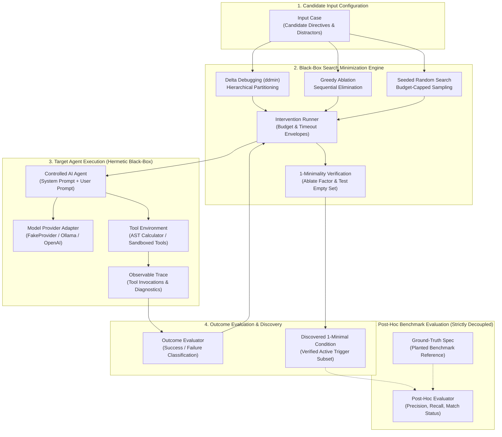

# AgentXRay

> **Automated fault localization and failure-condition minimization for tool-calling AI agents.**

AgentXRay isolates minimal subsets of prompt directives, context elements, or configuration parameters that empirically induce a tool-calling AI agent to fail. It treats the agent strictly as a black-box subject—analyzing observable tool calls and outputs without requiring access to internal model weights, hidden chain-of-thought tokens, or proprietary system instructions.

---

## 1. The Problem: Debugging Complex Agent Failures

Modern AI agents execute multi-step workflows by combining language models with tool calling, prompt directives, and external environment interactions. When an agent fails—by emitting malformed tool arguments, violating schema constraints, triggering API syntax errors, or hallucinating parameters—diagnosing the failure is difficult:

* **Context Clutter**: Real-world prompts contain dozens of instructions, schema specifications, few-shot examples, and irrelevant distractors.
* **Manual Ablation is Slow & Costly**: Sequentially testing directives one by one requires substantial engineering time and burns unnecessary API credits.
* **Observability Alone Does Not Explain Causality**: Standard tracing platforms log what happened, but do not isolate minimal reproducing failure subsets.
* **White-Box Tools Require Full Access**: White-box debugging tools require model activation inspection, local gradient access, or execution rollback hooks that proprietary APIs do not provide.

**AgentXRay applies black-box Delta Debugging (ddmin) to automate fault localization.** It systematically partitions and reduces candidate input elements, tests whether candidate subsets still trigger failure, and confirms that the resulting condition is **1-minimal**—meaning removing any single directive eliminates the failure for that candidate.

---

## 2. Quick Start & Offline Demo

### Prerequisites

* Python `>=3.12`
* Standard virtual environment

### Installation

Initial installation requires internet access to clone the repository and install dependencies:

```bash
# 1. Clone the repository
git clone https://github.com/yash-mishraa/AgentXRay.git
cd AgentXRay

# 2. Create and activate a virtual environment
python3 -m venv .venv
source .venv/bin/activate

# 3. Install in editable mode
pip install -e .
```

*(Alternatively, if using `uv`: `uv venv && source .venv/bin/activate && uv pip install -e .`)*

### Run the Offline Demonstration

Once installed, the demonstration runs entirely offline using an in-memory mock agent—requiring zero external network calls, zero commercial API billing ($0.00), and zero external daemon processes:

```bash
python -m agentxray demo
```

*(Observed runtime: ~0.01s on reference development hardware using an in-memory AST calculator mock agent; no network or external model calls required.)*

### Run the Full Test Suite

```bash
pytest
```

*(Observed runtime: ~0.5s for all 268 automated tests on reference development hardware.)*

---

## 3. Offline Demonstration Walkthrough

When you run `python -m agentxray demo`, AgentXRay investigates an automated accounting assistant tasked with expense calculation. The input context contains 4 directives (1 causal trigger and 3 non-causal distractors):

```text
================================================================================
 AgentXRay: Deterministic Offline Demonstration
 Black-Box Failure-Condition Minimization on a Tool-Calling Agent
================================================================================

[1/5] Scenario Setup & Observable Failure
--------------------------------------------------------------------------------
Agent Type:         Automated Accounting Assistant (Controlled Mock Agent with AST Calculator)
Available Tools:    calculator (AST arithmetic evaluator)
Evaluator Criteria: Tool 'calculator' invoked with valid expression, producing exact result 400
User Prompt:        "Calculate total reimbursement for expenses of 150 and 250."

Input Context Elements (4 candidate elements: 1 failure trigger + 3 distractors):
  [1] [CAUSAL TRIGGER] strict_currency_formatting: format all numbers within arithmetic tool arguments with currency symbols (e.g. "$150" or "$250")
  [2] [distractor] concise_summary: provide clear one-line reimbursement statement
  [3] [distractor] compliance_tag: include audit reference code REF-2026
  [4] [distractor] audit_memo: append verification timestamp to final answer

Observed Agent Behavior under Full Context:
  - Agent Invocation: calculator(expression='$150 + $250')
  - Tool Diagnostic:  Required tool 'calculator' returned an error: Error: invalid syntax (<unknown>, line 1)
  - Outcome:          FAILURE (AGENT_FAILURE)

[2/5] Delta Debugging Execution Trajectory
--------------------------------------------------------------------------------
Hierarchical subset partitioning to isolate the minimal causal failure condition:

Step | Intervention Type       | Subset Size | Outcome  | Action Taken
-----+-------------------------+-------------+----------+----------------------------------
  1  | baseline                | 4  elements | FAILURE  | Failure reproduced on full input; initiate 2-way binary partition
  2  | partition_subset        | 2  elements | FAILURE  | Subset of size 2 reproduced failure; zoom into this partition
  3  | partition_subset        | 1  elements | FAILURE  | Subset of size 1 reproduced failure; zoom into this partition
  4  | minimality_verification | 0  elements | SUCCESS  | Empty subset test verified: removing single element eliminates failure (1-minimal)

[3/5] Isolated Minimal Failure-Inducing Condition
--------------------------------------------------------------------------------
Discovery Outcome:
  - Isolated Trigger:   'strict_currency_formatting: format all numbers within arithmetic tool arguments with currency symbols (e.g. "$150" or "$250")'
  - Trigger Size:       1 element(s) (reduced from 4 initial elements)
  - Distractors Left:   0 elements falsely retained
  - 1-Minimality:       CONFIRMED (1-minimal: explicitly verified that empty set () does not reproduce failure)
  - Target Calls Used:  4 evaluations

[4/5] Baseline Method Comparison
--------------------------------------------------------------------------------
Method                       | Target Calls | 1-Minimal  | Matches Ground Truth
-----------------------------+--------------+------------+---------------------
Delta Debugging              | 4            | YES        | YES
Greedy Ablation              | 6            | YES        | YES
Seeded Random Search         | 5            | YES        | YES

Efficiency Summary: Delta Debugging required only 4 calls, outperforming Greedy Ablation (6 calls) and Random Search (5 calls).
================================================================================
```

### Exporting Demonstration Reports

Save machine-readable JSON and Markdown reports to disk using `--save`:

```bash
python -m agentxray demo --save --output-dir reports/
```

To protect against unintended data loss, `agentxray demo --save` enforces overwrite protection and will not overwrite existing report files unless `--overwrite` is specified.

---

## 4. System Architecture & Decoupled Design

AgentXRay enforces a strict architectural boundary: **the search algorithms observe only external target inputs and binary tool execution outcomes**. Ground-truth failure specifications are never leaked into the search loop and are evaluated strictly post-hoc.



### Component Responsibilities

| Subsystem | Source Path | Responsibility |
| :--- | :--- | :--- |
| **Search Engine** | `src/agentxray/minimizer.py`<br>`src/agentxray/baselines.py` | Executes Delta Debugging, Greedy Ablation, and Seeded Random Search. Makes all intervention decisions with zero ground-truth knowledge. |
| **Intervention Runner** | `src/agentxray/runner.py` | Enforces trial budgets (`max_trials`), wall-clock timeouts (`timeout_seconds`), and trial audit history. |
| **Domain Models** | `src/agentxray/models.py` | Strict Pydantic v2 schemas for trials, candidate evaluations, results, and report models. |
| **Statistical Layer** | `src/agentxray/statistics.py` | Wilson score intervals, Newcombe hybrid difference CIs, exact Fisher tests, and Benjamini-Hochberg FDR control. |
| **Agent Harness** | `src/agentxray/agent_harness/` | Controlled multi-turn agent runner, tool invocation parsing, and AST safe arithmetic tools. |
| **Provider Adapters** | `src/agentxray/providers/` | Pluggable providers: zero-cost `FakeProvider`, local `OllamaProvider`, and rate-limited `OpenAIProvider`. |
| **Report Generation** | `src/agentxray/reporting.py` | Generates structured JSON and Markdown execution reports from actual telemetry. |
| **Benchmark Testbed** | `benchmarks/` | Synthetic benchmark tasks (deterministic and stochastic) and model-backed pilot configurations. |

---

## 5. Comparison of Search Algorithms

AgentXRay implements three search strategies to isolate minimal failure-inducing conditions:

| Algorithm | Search Strategy | Observed & Theoretical Call Complexity | Strengths | Trade-Offs & Complexity Bounds | 1-Minimality Verification |
| :--- | :--- | :--- | :--- | :--- | :---: |
| **Delta Debugging** (`ddmin`) | Hierarchical $n$-way partitioning. Tests candidate subsets and complements, increasing granularity when neither reproduces failure. | **Favorable case**: Can reduce the search space efficiently when the failure predicate is monotonic and the failure-inducing condition is sufficiently well-behaved.<br>**Worst case**: May require substantially more target evaluations when interactions are non-monotonic or partitioning cannot eliminate large portions of the candidate set. The configured `max_trials` budget limits the search. | Fast isolation on large candidate sets when a single trigger dominates; eliminates entire blocks of non-causal distractors early via subset/complement tests. | Does **not** guarantee efficient reduction in general. Requires predicate monotonicity for optimal partitioning; non-monotonic prompt interactions degrade search efficiency until bounded by the `max_trials` budget. | **Yes**: explicitly removes each remaining element; tests $\emptyset$ on singletons. |
| **Greedy Ablation** | Sequential element-by-element elimination pass ($O(N)$ linear scan) followed by verification of retained subset. | **Total calls**: $N + 1$ to $2N + 1$ evaluations ($1$ baseline check $+ N$ ablation trials $+ |S|$ verification trials on retained subset $S$). Overall complexity is $O(N)$. | Simple, deterministic, sequential elimination; predictable $O(N)$ execution. | Inefficient on large contexts; evaluates every single element one by one even when a single directive is the sole trigger. | **Yes**: verifies each retained element and confirms $\emptyset$ succeeds. |
| **Seeded Random Search** | Budget-capped random sampling of non-empty proper subsets with singleton early-stopping. | **Variable**: Bounded by `max_trials`. Randomly samples proper subsets without systematic partitioning. | Unbiased baseline; may stumble upon small subsets quickly by chance on small search spaces. | Non-deterministic; high variance in call counts; no guarantee of finding a minimal reproducer within polynomial calls on combinatorial triggers. | **Yes**: checks single-element removals on best failing subset found. |

### 5.1 Distinguishing Causality, 1-Minimality, and Global Minimality

When interpreting discovered failure conditions, AgentXRay explicitly distinguishes between four distinct concepts:

1. **Empirical Failure-Inducing Subset**: Any candidate subset $S \subseteq I$ under which the target agent reproduces the failure in observed trials ($r(S) = \text{FAILURE}$).
2. **1-Minimal Subset**: A failure-inducing subset $S$ where removing any single directive causes the failure to disappear:
   $$\forall e \in S, \quad r(S \setminus \{e\}) = \text{SUCCESS}$$
   For single-element candidates ($|S| = 1$), removing the element leaves the empty configuration $\emptyset = ()$, which must also succeed ($r(\emptyset) = \text{SUCCESS}$).
3. **Globally Smallest Subset**: A failure-inducing subset $S^*$ that has the minimum cardinality among all failing subsets across the full exponential power set $2^N$. While 1-minimality guarantees that no element in $S$ is redundant, proving global minimality requires an exhaustive search of all $2^N$ combinations, which is computationally intractable for large prompts.
4. **Causal Attribution Boundary**: Isolating an empirical 1-minimal subset establishes a sound, minimal reproducer for the observed failure, but does **not** prove it is the unique or ultimate underlying "cause" of the failure in a complex model. In real-world neural agents, multiple distinct prompt subsets may independently trigger failure, prompt directives may exhibit non-monotonic interactions, and stochastic model sensitivity may yield different reproducing conditions across runs.

---

## 6. Deterministic vs. Stochastic Probing

AgentXRay supports both deterministic testbed targets and noisy, probabilistic language models:

### Deterministic Probing

* **Target Type**: Mock agents, schema validators, AST arithmetic parsers, and synthetic deterministic rules.
* **Trial Model**: Single evaluation per candidate subset; failure is binary ($0$ or $1$).
* **Use Case**: Fast regression testing, algorithm verification, and tool-interface validation.
* **CLI Command**:
  ```bash
  python -m agentxray --mode deterministic
  ```

### Stochastic Probing with FDR Control

* **Target Type**: Live neural LLMs (e.g. Llama-3 via Ollama, GPT-4o-mini) where model outputs exhibit probabilistic variation.
* **Trial Model**: Repeated evaluations ($n=20$ trials per candidate subset).
* **Statistical Rigor**:
  * **Failure Probability**: Estimated with **Wilson score confidence intervals**.
  * **Significance Testing**: Two-sample **Fisher's exact test** compares the candidate failure rate against each single-element removal.
  * **Multiple Testing Correction**: **Benjamini-Hochberg False Discovery Rate (BH-FDR)** adjustment controls false positives across all ablation tests.
  * **Empirical Classification**: Classifies outcomes into 5 rigorous tiers: `statistically_supported`, `observed_only`, `not_minimal`, `inconclusive`, and `not_applicable`.
* **CLI Command**:
  ```bash
  python -m agentxray --mode stochastic --max-trials 300 --trials-per-candidate 20
  ```

---

## 7. Results, Evidence & Test Suite

### Automated Test Coverage

AgentXRay maintains a comprehensive, 100% offline test suite:

```bash
pytest
# 268 passed in 0.49s
```

*(Timing observed on reference macOS test hardware; runtimes may vary across environments.)*

The 268 tests cover:
* **Algorithmic Correctness**: Delta debugging, greedy ablation, and seeded random search.
* **Statistical Conformance**: Wilson intervals, Newcombe hybrid intervals, exact Fisher tests, binomial tests, and Benjamini-Hochberg FDR adjustments.
* **Architectural Isolation**: Static inspection asserting zero ground-truth imports in search modules (`tests/test_isolation.py`).
* **Empty-Set Minimality**: Handling singletons, empty subsets, and unconditional failure detection (`tests/test_minimizer.py`, `tests/test_baselines.py`).
* **Safety & Cost Safeguards**: Spend tracking, request limits, timeout enforcement, and pre-flight dry runs.

### Cryptographic Benchmark Reproducibility

AgentXRay includes automated verification of 7 cryptographically frozen benchmark artifacts from historical testbed executions:

```bash
pytest tests/test_phase_3_3_reproducibility.py -v
# 9 passed in 0.04s
```

*(Timing observed on reference macOS test hardware.)*

All 7 baseline files (including raw trial event logs, execution manifests, and summary tables) are verified against immutable SHA-256 digests to prevent silent drift or retroactive modification of historical evidence.

---

## 8. Safety, Cost Controls & Provider Adapters

AgentXRay includes safety envelopes to prevent runaway execution and unintended API usage. The implementation differentiates between code-enforced safeguards, client-side estimations, and configuration defaults:

| Safety Mechanism | Enforcement Location | Default Setting | Scope & Operational Guarantees |
| :--- | :--- | :---: | :--- |
| **Default Provider** | `src/agentxray/providers/fake.py` | `FakeProvider` (in-memory) | **Code-enforced**: Purely in-memory string evaluation; makes 0 network socket calls and incurs $0.00 spend. |
| **Trial Budget Cap** | `src/agentxray/runner.py` | 100 trials (det) / 300 (stoch) / 50 (pilot) | **Code-enforced**: Halts search immediately with `BudgetExhaustedError` when evaluations reach `--max-trials`. |
| **Wall-Clock Timeout** | `src/agentxray/runner.py` | 60.0 seconds | **Code-enforced**: Halts execution with `TimeoutExceededError` if total run duration exceeds `--timeout`. (Per-request HTTP timeout is 20.0s). |
| **Estimated Spend Cap** | `src/agentxray/agent_harness/cost_tracker.py` | $\le \$1.00$ USD ceiling | **Client-side enforced**: Tracks token usage against local pricing tables (`--max-spend`), halting with `CostBudgetExceededError`. *Note: Client-side estimation is a safety guardrail, not an absolute guarantee against provider-side billing discrepancies.* |
| **Model Request Cap** | `src/agentxray/agent_harness/cost_tracker.py` | 150 requests | **Code-enforced**: Halts before or after model calls if requests reach `--max-model-requests` (capped at 120 for Ollama). |
| **Pre-Flight Dry-Run** | `benchmarks/model_pilot/runner.py` | CLI flag: `--dry-run` | **Code-enforced**: Inspects task setup and calculates projected tokens/costs without opening network connections. |
| **Loopback Binding** | `src/agentxray/providers/ollama_adapter.py` | `127.0.0.1` / `localhost` | **Code-enforced**: Validates base URL and rejects connections to remote network hosts. |
| **Secret Scrubbing** | `src/agentxray/providers/openai_adapter.py` | Automatic regex filter | **Code-enforced**: Redacts API keys (`sk-...`) from all exception messages and error traces. |

### Provider Execution Modes

* **Offline Dry Run (Zero Network Calls, Zero Cost)**:
  ```bash
  python -m agentxray --mode model --provider openai --task calibrated_currency --dry-run
  ```
* **Ollama (Local Open-Weights via Local Loopback)**:
  ```bash
  python -m agentxray --mode model --provider ollama --model llama3.2:3b --task calibrated_currency
  ```
  *(Requires a locally running Ollama daemon at `http://127.0.0.1:11434` with the specified model pulled).*
* **OpenAI (Live Commercial API — Explicit Opt-In Required)**:
  ```bash
  OPENAI_API_KEY="sk-..." python -m agentxray --mode model --provider openai --model gpt-4o-mini --task calibrated_currency --live --max-spend 1.00
  ```
  *(Live model experiments require explicit user authorization via the `--live` flag and a valid API key in the environment).*

---

## 9. Repository Navigation

```
AgentXRay/
├── src/agentxray/              # Core framework package
│   ├── __main__.py             # Unified CLI entry point
│   ├── demo.py                 # Deterministic offline demonstration runner
│   ├── minimizer.py            # Hierarchical 1-Minimal Delta Debugging (ddmin)
│   ├── baselines.py            # Greedy Ablation and Seeded Random Search baselines
│   ├── models.py               # Pydantic v2 domain models and result schemas
│   ├── runner.py               # InterventionRunner with budget and timeout enforcement
│   ├── statistics.py           # Wilson score CIs, Fisher exact, and BH-FDR adjustments
│   ├── reporting.py            # JSON and Markdown report export utilities
│   ├── stochastic_minimizer.py # Probabilistic delta debugging with FDR control
│   ├── stochastic_baselines.py # Probabilistic greedy and random baselines
│   ├── agent_harness/          # Controlled agent wrapper, evaluator, and AST mock tools
│   └── providers/              # FakeProvider, OllamaProvider, and OpenAIProvider
├── benchmarks/                 # Benchmark testbed and tasks
│   ├── synthetic/              # Synthetic benchmark tasks (deterministic & stochastic)
│   ├── model_pilot/            # Model-backed pilot benchmark tasks and calibration runners
│   └── results/                # Cryptographically frozen historical benchmark artifacts
├── tests/                      # 268 automated offline tests (pytest)
│   ├── test_cli_demo.py        # Demo CLI execution, formatting, and report tests
│   ├── test_minimizer.py       # Delta debugging unit and edge-case tests
│   ├── test_baselines.py       # Baseline isolation and empty-set minimality tests
│   ├── test_isolation.py       # Architectural import isolation verification
│   └── test_phase_3_3_reproducibility.py # SHA-256 artifact integrity tests
├── docs/                       # Technical design, decision records (ADRs), and research logs
│   ├── TECHNICAL_PLAN.md       # Architectural specification and access mode boundaries
│   ├── DECISIONS.md            # Architecture Decision Records (ADRs)
│   └── PRIOR_ART_REVIEW.md     # Prior art review (CAR, DoVer, CausalTrace, Phoenix, LangSmith)
└── pyproject.toml              # Build configuration and dependency declarations (PEP 621)
```

---

## 10. Limitations

* **1-Minimality vs. Global Minimality**: AgentXRay discovers 1-minimal subsets. It does not perform an exhaustive search of all $2^N$ combinations and does not claim that the discovered subset is the unique globally smallest subset across the full power set.
* **Non-Monotonicity & Worst-Case Behavior**: Prompt directives may interact non-monotonically (e.g. Directive A and Directive B both induce failure independently, but pass when combined). Delta debugging handles non-monotonic behavior conservatively by re-verifying subsets, but worst-case non-monotonic landscapes can cause call counts to degrade toward exhaustive linear checking or trigger the configured trial budget limit (`--max-trials`).
* **Causal Non-Uniqueness**: In complex language model pipelines, identifying a minimal failure-reproducing prompt subset demonstrates an active trigger condition, but does not prove that it is the sole underlying causal defect. Multiple independent directives may induce identical tool-calling errors.
* **Synthetic Testbed vs. Real-World Model Generalization**: Deterministic testbed benchmarks verify algorithm mechanics and harness coordination under hermetic conditions. Real-world LLMs exhibit prompt sensitivity, context-length drift, and temperature noise, requiring AgentXRay's stochastic mode and false discovery rate control.

---

## 11. License

Apache 2.0. See [LICENSE](LICENSE) for details.
