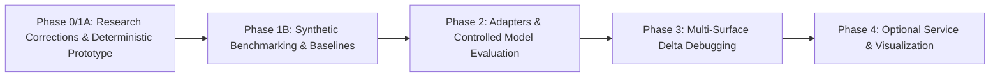

# AgentXRay

> **Investigating and reverse-engineering the observable behaviour of AI agents through controlled experiments.**

---

> [!NOTE]
> **Research Status — Phase 1B Audit & Statistical Validation (October 2026)**
> **Stochastic synthetic experimentation and rigorous statistical reliability framework validated.**
> AgentXRay provides deterministic (Phase 1A), probabilistic binomial (Phase 1B), and multi-seed audit experimentation modes with rigorous uncertainty bounds: Wilson score intervals, Newcombe difference intervals, exact Fisher's tests via integer combinatorics, BH-FDR adjustments, and five-tier epistemic minimality classification (`statistically_supported`, `observed_only`, `not_minimal`, `inconclusive`, `not_applicable`). Synthetic testbed success must not be interpreted as evidence of real-world LLM agent reverse-engineering capability.

---

## 1. Executive Overview

Modern AI agents—combining Large Language Models (LLMs) with tool calling, multi-step planning, iterative execution, and external environment interaction—frequently fail in subtle, non-deterministic, and difficult-to-reproduce ways. When an agent hallucinates an API parameter, invokes the wrong tool, enters an infinite loop, or misinterprets instructions, developers struggle to determine *why* the failure occurred.

Existing evaluation and observability platforms (such as Langfuse, LangSmith, and Arize Phoenix) provide valuable tracing, dataset evaluation, and regression testing, but primarily report observed execution logs and evaluator scores rather than performing automated, minimal causal fault isolation. Meanwhile, white-box causal debugging tools (such as Causal Agent Replay or DoVer) require deep internal instrumentation, access to intermediate model activations, or runtime execution rollback and replay hooks.

**AgentXRay** explores whether **controlled intervention experiments**—systematically applying one-variable-at-a-time perturbations, delta debugging, and statistical inference across an agent's observable boundaries—can isolate minimal failure-triggering conditions **without requiring access to internal weights, hidden prompts, or runtime execution traces**.

---

## 2. Operational Access Modes

To avoid unrealistic assumptions about what external systems expose, AgentXRay distinguishes between two operational modes:

1. **Black-Box Mode**:
   * *Available Boundary*: Only authorized external inputs (e.g. user messages) and observable outputs (e.g. final responses, emitted tool call invocations) are accessible.
   * *Constraints*: Arbitrary external agents do **not** expose internal system instructions, tool schemas, or environment states. Interventions in this mode are strictly restricted to input prompt transformations.
2. **Controlled-Testbed Mode**:
   * *Available Boundary*: The experimenter hosts or configures the agent harness, enabling controlled manipulation of input configurations, tool descriptions, parameter schemas, and mock environment return values.
   * *Application*: Used for development-time debugging, regression testing, and local benchmark evaluation where the test harness has full configuration authority.

---

## 3. Epistemic and Causal Principles

To prevent overconfident conclusions and speculative diagnoses, AgentXRay adheres to strict epistemic and causal distinctions:

```
+--------------------------------------------------------------------------------+
|                             AGENTXRAY EPISTEMIC MODEL                          |
+--------------------------------------------------------------------------------+
| 1. Directly Observed Behaviour : Raw, unmanipulated inputs, outputs, tool calls|
| 2. Measured Experimental Effect: Statistically significant delta under control |
| 3. Plausible Explanation       : Generated hypothesis meeting consistency tests|
| 4. Established Causal Claim    : Formally identified under documented controls |
| 5. Explicit Unknown            : Inadequately supported or unobservable state   |
+--------------------------------------------------------------------------------+
```

### Statistical Significance vs. Causal Attribution
Statistical significance ($p < 0.05$) alone does **not** establish causation. Causal claims require:
* **Exogeneity / Unconfoundedness**: The intervention must be the sole factor systematically varied between treatment and control.
* **Stable Unit Treatment Value Assumption (SUTVA)**: One trial's intervention must not alter another trial's outcome (enforced via stateless or hermetically reset sessions).
* **Positivity**: Every candidate state must have a non-zero probability of execution.
* **Appropriate Control Comparisons**: Treatment outcomes must be measured against identical baseline controls rather than historical unperturbed runs.

### 1-Minimality vs. Global Minimality
* **1-Minimal Trigger**: A failure-inducing input subset where removing any *single* element causes the failure to disappear. Multiple 1-minimal subsets may exist for the same failure.
* **Globally Minimal Trigger**: The absolute smallest subset among all possible subsets that reproduces the failure.
AgentXRay's delta-debugging algorithms seek 1-minimal subsets and explicitly do not claim global minimality unless an exhaustive power-set search has been performed.

**AgentXRay must never claim to know hidden prompts, internal chain-of-thought tokens, model weights, or internal architectural states when those are not observable.**

---

## 4. Documentation Index

The research, prior-art landscape, proposal, architecture, and design decisions are documented in the `docs/` directory:

| Document | Description |
| :--- | :--- |
| [`docs/PRIOR_ART_REVIEW.md`](docs/PRIOR_ART_REVIEW.md) | Prior art review covering CAR, DoVer, CausalTrace, DDOR, Phoenix, Langfuse, LangSmith, verified references, and candidate gaps. |
| [`docs/RESEARCH_PROPOSAL.md`](docs/RESEARCH_PROPOSAL.md) | Central research question, provisional hypotheses, synthetic testbed methodology, real-world benchmark requirements, and threats to validity. |
| [`docs/TECHNICAL_PLAN.md`](docs/TECHNICAL_PLAN.md) | System architecture, access mode separation, security & sandboxing, technology stack, and phased implementation roadmap. |
| [`docs/DECISIONS.md`](docs/DECISIONS.md) | Architecture Decision Records (ADRs), trade-offs, and open questions requiring review. |

---

## 5. Project Roadmap



* **Phase 1A (Completed)**: Research document corrections and minimal deterministic vertical slice (typed schemas, synthetic target, 1-minimal delta debugger, greedy and random baselines, local reports).
* **Phase 1B (Completed)**: Probabilistic synthetic benchmark suite (single-factor, conjunctive, distractor-heavy, null, non-monotonic, weak-signal); statistical layer (Wilson score CIs, Newcombe difference CIs, Benjamini-Hochberg FDR, Cohen's h power estimation); stochastic baselines; four-tier minimality classification.
* **Phase 2**: Controlled-testbed adapters (OpenAI, Anthropic) with local mock environments; evaluation on actual model-backed agents with human-verified root causes.
* **Phase 3**: Multi-surface delta debugging (prompts + tool schemas in controlled-testbed mode).
* **Phase 4**: Optional service layer and visualization interface, strictly contingent on research utility.

---

## 6. Quickstart & CLI Execution

AgentXRay runs locally with zero external network or database requirements:

```bash
# 1. Install dependencies and local package in editable mode
uv pip install -e .

# 2. Run the deterministic synthetic benchmark suite (Phase 1A)
agentxray --mode deterministic

# 3. Run the stochastic synthetic benchmark suite with uncertainty estimation (Phase 1B)
agentxray --mode stochastic --max-trials 300 --trials-per-candidate 20

# 4. Run the multi-seed stochastic audit across prespecified seeds
agentxray --mode audit --audit-seeds 42,43,44,45,46

# 5. Run all benchmark suites
agentxray --mode all

# 6. Execute full test suite
pytest
```

---

## 7. Responsible Research and Ethical Constraints

1. **Authorization Required**: Probing may only be conducted against systems owned by the operator or for which explicit testing permission has been granted.
2. **No Intrusive Extraction**: AgentXRay does not perform jailbreaks, adversarial prompt injection attacks, or proprietary extraction against third-party endpoints.
3. **Safe Sandboxing**: Mock environments intercept tool calls to prevent unintended side effects (e.g. destructive file modification or live API execution).
4. **Data Privacy**: All experiment artifacts remain local; API keys and secrets are never logged.

---

## 8. License

Apache 2.0.
