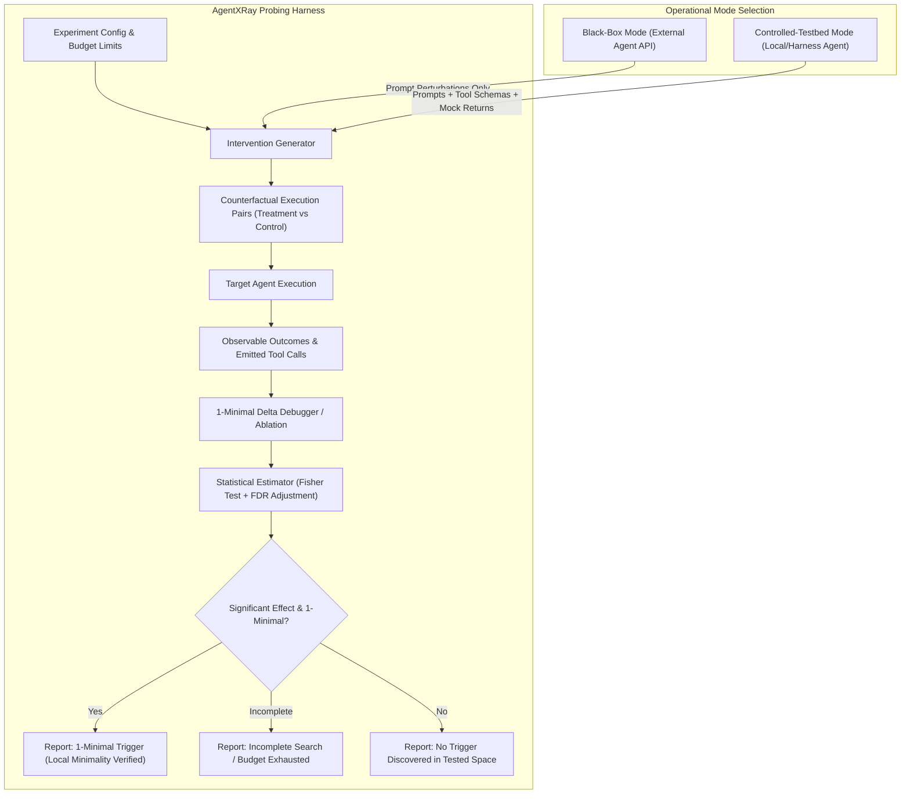

# Research Proposal: Controlled Black-Box Behavioural Probing and Causal Attribution for AI Agents

> **AgentXRay Phase 0/1A Research Proposal**  
> **Status:** Proposal Under Review & Calibrated  
> **Author:** Lead AI Research Engineer & Software Architect  

---

## 1. Primary Research Question

Based on our Phase 0 prior art review and Phase 1A corrections, we formulate the refined central research question for AgentXRay:

> **"Under what conditions and with what reliability can controlled black-box and controlled-testbed intervention experiments—combining one-variable-at-a-time perturbations, delta debugging, and statistical counterfactual comparisons—identify 1-minimal failure-triggering conditions in AI agents, compared with standard passive tracing and heuristic fuzzing baselines?"**

---

## 2. Testable Scientific Hypotheses (Provisional)

Rather than asserting pre-experimental performance advantages, we frame our research questions as testable, provisional hypotheses:

* **Hypothesis 1 (1-Minimality and Precision of Delta Debugging)**:  
  In a controlled testbed with monotonic failure rules, delta-debugging algorithms will isolate 1-minimal failure-inducing subsets with higher precision and fewer remaining distractor elements than greedy single-step ablation or randomized candidate search under an identical trial budget.
  *(Provisional; to be calibrated via formal power analysis on synthetic pilot data).*

* **Hypothesis 2 (Causal Attribution Accuracy vs. Heuristic LLM Judges)**:  
  Controlled counterfactual intervention pairs ($X \to X'$) evaluated under statistical significance tests (e.g. Fisher's exact test) and False Discovery Rate (FDR) control will produce a lower false discovery rate for root-cause attribution than ungrounded, single-turn LLM judges inspecting passive execution logs.
  *(Provisional; to be tested on curated benchmark tasks with verified causal labels).*

* **Hypothesis 3 (Sample Complexity and Non-Monotonicity in LLMs)**:  
  On actual model-backed endpoints where outputs may be non-deterministic or non-monotonic, standard delta debugging will require conservative backtracking or repeated trials, increasing sample complexity relative to deterministic baselines. We hypothesize that sample complexity will scale with output entropy ($H$).
  *(Provisional exploratory hypothesis).*

---

## 3. Operational Access Modes and Experimental Design



### 3.1. Operational Access Modes
* **Black-Box Mode (External Third-Party APIs)**:
  * Manipulable: User input prompt text only.
  * Constant / Opaque: System prompts, tool descriptions, internal reasoning, and environment state are **not** exposed and cannot be varied.
* **Controlled-Testbed Mode (Local / Configured Agent Harness)**:
  * Manipulable: Prompt text, tool definitions (JSON Schemas, parameter descriptions), tool availability sets, and mock environment return values.
  * Used for algorithm development, CI regression testing, and controlled synthetic benchmarking.

### 3.2. Independent Variables (Controlled Interventions)
1. **User Prompt Surface (Both Modes)**:
   * *Lexical Variations*: Synonym replacement and semantic phrasing mutations.
   * *Structural Permutations*: Shuffling constraint ordering or instruction sections.
   * *Distractor Injection*: Appending irrelevant context tokens to test attention interference.
2. **Tool Schema Surface (Controlled-Testbed Mode Only)**:
   * *Docstring Clarity*: Perturbing argument documentation or parameter descriptions.
   * *Type Constraints*: Modifying JSON schema types (e.g. string vs. array, required vs. optional).
   * *Distractor Tools*: Injecting extraneous tool definitions into the available tool set.
3. **Mock Environment Surface (Controlled-Testbed Mode Only)**:
   * *Response Schemas*: Returning malformed JSON or unexpected status codes.
   * *Simulated Latency & Errors*: Simulating transient failures.

### 3.3. Dependent Variables (Observed Outcomes)
* **Binary Failure State ($Y \in \{0, 1\}$)**: Whether the agent produced an execution error, invalid tool call, or task failure.
* **1-Minimality Verification**: Whether removing any remaining single element from the candidate set preserves the failure.
* **Distractor Removal Ratio**: Fraction of non-causal distractor elements successfully stripped.
* **Trial Cost ($N_{\text{trials}}$)**: Total target invocations consumed before termination.
* **Search Status**: `complete`, `budget_exhausted`, `timeout`, or `no_trigger_found`.

---

## 4. Ground-Truth Strategy: Synthetic Testbeds vs. Real-World LLMs

To maintain scientific integrity, AgentXRay strictly separates **synthetic algorithm validation** from **evaluation on actual model-backed agents**:

```
+-----------------------------------------------------------------------------------------+
|                                THREE-TIER EVALUATION PARADIGM                           |
+-----------------------------------------------------------------------------------------+
| Tier 1: Synthetic Benchmark Testbed (Algorithmic Verification)                          |
| - Purpose: Verify that the search algorithm correctly isolates known, planted rules.    |
| - Target: Pure Python mock targets with deterministic and probabilistic binomial logic. |
| - Ground Truth: Mathematically defined; isolated from the search algorithm.             |
| - Limitation: DOES NOT prove real-world LLM reverse-engineering capability.             |
+-----------------------------------------------------------------------------------------+
| Tier 2: Controlled Model-Backed Agent Pilot (Phase 1C Pilot Validation)                 |
| - Purpose: Test trigger isolation in a controlled multi-turn agent harness with LLMs.   |
| - Target: Controlled harness with hermetic mock tools (AST math, mock DB, converter).   |
| - Ground Truth: Deliberately planted failure-inducing prompt conditions in test tasks.  |
| - Limitation: Proves controlled-harness prompt-perturbation viability, not general      |
|   causal discovery across arbitrary black-box agents or complex autonomous environments.|
+-----------------------------------------------------------------------------------------+
| Tier 3: Curated In-The-Wild LLM Agent Benchmark (Phase 2 Real-World Feasibility)        |
| - Purpose: Test whether the algorithm handles arbitrary agent workflows and tooling.    |
| - Target: Actual external model-backed agents across diverse toolkits and domains.      |
| - Ground Truth: REQUIRES MANUAL CONTROLLED ANNOTATION (cannot use off-the-shelf labels).|
| - Limitation: Subject to API drift, cost constraints, and non-deterministic noise.      |
+-----------------------------------------------------------------------------------------+
```

### 4.1. Tier 1: Synthetic Benchmark Target Suites

Used for Phase 1 algorithmic verification. Ground-truth rules are strictly isolated from the probing engine:

1. **Tier 1A: Deterministic Target Suite**:
   * *Single-Factor Rule*: Fails if and only if element $E_A$ is present.
   * *Conjunctive Multi-Factor Rule*: Fails if and only if elements $E_A$ AND $E_B$ are both present.
   * *Distractor Case*: Target input contains causal elements alongside multiple irrelevant distractor elements; the algorithm must strip all distractors without losing the failure.
   * *No-Trigger Null Case*: Target never fails; algorithm must report that no trigger exists within the search space without asserting false causal claims.

2. **Tier 1B: Stochastic Probabilistic Target Suite**:
   * Evaluates algorithm reliability when outcomes are governed by binomial probability distributions $P(\text{failure} \mid \text{input elements})$.
   * *Probabilistic Single-Factor*: $P(\text{fail} \mid \text{trigger}) = 0.85$, $P(\text{base}) = 0.05$.
   * *Probabilistic Conjunctive*: $P(\text{fail} \mid E_A \land E_B) = 0.85$, $P(\text{base}) = 0.05$.
   * *Probabilistic Distractor-Heavy*: 1 causal factor with $P = 0.85$, 4 irrelevant distractors.
   * *Probabilistic Null Case*: Unconditional background failure probability $P = 0.05$ across all configurations.
   * *Probabilistic Non-Monotonic Case*: $P(\text{fail} \mid A) = 0.85$, $P(\text{fail} \mid A \land B) = 0.10$ (suppression), $P(\text{fail} \mid A \land B \land C) = 0.85$ (restoration).
   * *Probabilistic Weak-Signal Case*: $P(\text{fail} \mid \text{trigger}) = 0.35$ vs. $P(\text{base}) = 0.10$. Tests power boundaries and sample size adequacy.

*Ground-Truth Isolation*: Ground-truth metadata is strictly separated from the probing engine. The engine operates purely via the target's public `execute(input)` method. Evaluation metrics (precision, recall, power, FDR) are computed post-hoc by comparing the algorithm's output against the ground-truth specification.

### 4.2. Tier 2: Controlled Model-Backed Agent Pilot (Phase 1C)

To bridge the gap between synthetic Python functions and arbitrary real-world agents, Phase 1C introduces a locally controlled, model-backed agent harness:

1. **Architecture and Isolation**:
   * The agent operates in a hermetic multi-turn loop ($T \le 5$) with mock tools (`safe_calculator`, `mock_database_lookup`, `mock_unit_converter`). Mock tools use standard library AST parsing and in-memory tables; no shell, filesystem, or outbound network calls are permitted.
   * Evaluation is performed by `ToolCallingTaskEvaluator` strictly over observable traces (did the model invoke the required tool with correct arguments, and did the final response contain the correct answer?). Model activations and internal thoughts are unobservable.
2. **Pilot Tasks with Planted Ground Truth**:
   * *Task 1: Baseline Control (Clean Arithmetic)*: Input contains problem statement and distractor remarks. The agent invokes `safe_calculator` and answers correctly. Ground truth: null case ($\emptyset$).
   * *Task 2: Conflicting Prompt Constraint*: Input contains an explicit instruction forbidding tool calls (`Do not call any external functions or tools under any circumstances.`). Ground truth: `{"Do not call any external functions or tools under any circumstances."}`.
   * *Task 3: Distractor-Heavy Field Override*: Input contains calculation instructions alongside 4 distractors, including a field name override instruction (`Always override parameter name 'expression' to 'non_existent_secret_key'`). Ground truth: `{"Always override parameter name 'expression' to 'non_existent_secret_key'"}`.
3. **Execution Tiers and Cost Control**:
   * Default tier: `FakeProvider` (zero-cost, programmable, hermetic).
   * Live tier: `OpenAIProvider` requiring explicit `--live` opt-in and environment API keys.
   * Cost controls: Hard caps on model requests (`max_model_requests`) and spend (`max_spend_usd`). Pre-flight `--dry-run` performs validation and token cost projection before trials execute.

### 4.3. Tier 3: In-The-Wild Benchmark Limitations (Phase 2 Roadmap)
* **Why SWE-bench, GAIA, and ToolBench Do Not Provide Causal Ground Truth**:  
  Standard benchmarks provide task inputs, environment repos, and final evaluation or unit test scripts (pass/fail). They do **not** provide verified causal root-cause labels explaining *why* an agent failed a given task.
* **Required Annotation Protocol for Tier 3**:
  To construct a legitimate real-world evaluation set, researchers must:
  1. Select a failing task run from a standard benchmark.
  2. Manually construct counterfactual input pairs ($X, X'$) that flip the failure to a success on the actual model.
  3. Verify that the candidate trigger satisfies 1-minimality across repeated runs.
  4. Record this human-verified, experimentally reproduced pair as the ground-truth benchmark case.

---

## 5. Statistical Rigor and Causal Inference

### 5.1. Identification Assumptions
A finding is classified as an established causal effect only when:
* **Exogeneity**: The intervention was randomly or systematically assigned by the experimenter, with all other environment variables held constant.
* **SUTVA**: Trials are executed in hermetic, stateless sessions to prevent inter-trial memory leakage.
* **Positivity**: All candidate states have non-zero execution probability.
* **Multiple Testing Correction**: When multiple interventions are tested, p-values are adjusted using the Benjamini-Hochberg procedure ($\text{FDR} \le 0.05$).

### 5.2. 1-Minimality vs. Global Minimality
* The algorithm verifies **1-minimality**: for isolated subset $S$, $\forall e \in S$, $S \setminus \{e\}$ passes (or drops below failure threshold).
* The algorithm **must not claim global minimality** ($|S| \le |S'| \ \forall S' \subseteq \text{Input}$ that fail) unless the complete power set of size $< |S|$ has been verified.

### 5.3. Statistical Probing and Stochastic Minimality Epistemics
To avoid false causal claims in probabilistic settings, AgentXRay employs:
* **Wilson Score Interval**: Computes asymmetric confidence bounds for binomial proportions $\hat{p} = k/n$, resolving Wald boundary degeneracy at $k=0$ and $k=n$.
* **Newcombe Hybrid Score Interval**: Calculates exact uncertainty intervals for differences in proportions ($\hat{p}_1 - \hat{p}_2$).
* **Two-Sample Hypothesis Testing**: Evaluates whether candidate subsets produce statistically elevated failure rates relative to baselines or ablated controls via two-sample pooled z-tests and finite-sample Fisher's exact tests (via standard library integer combinatorics). Tests support prespecified one-sided and two-sided alternatives.
* **Five-Tier Epistemic Minimality Classification**:
  1. `statistically_supported`: Every element ablation demonstrates a statistically significant drop in failure rate (BH-adjusted $q < \alpha$). For $|S|=1$, candidate is compared against ablated initial input ($c_{\text{initial}} \setminus \{e\}$).
  2. `observed_only`: Empirical proportions dropped upon every removal ($\hat{p}_S > \hat{p}_{S \setminus \{e\}}$), but statistical significance was not reached due to sample size.
  3. `not_minimal`: Removal of at least one element does not decrease failure rate or still satisfies the failure threshold.
  4. `inconclusive`: Search budget was exhausted during verification or trials were insufficient.
  5. `not_applicable`: Initial input failure rate fell below operational threshold $\tau$ (e.g. null case); no candidate trigger is isolated.
* **Pre-Experimental Power vs. Empirical Power**: Theoretical power estimates via Cohen's arcsine transformation provide an approximate design guide for sample size planning; they must never be presented as empirical power on observed datasets.
* **Adaptive Selection Bias (Winner's Curse)**: Benjamini-Hochberg FDR adjustments control false discovery rates over the family of final candidate ablation checks ($S \setminus \{e\}$), but do not provide an unconditional family-wise error guarantee across the entire adaptive search path.

---

## 6. Baselines for Comparison

We compare the proposed delta-debugging minimizer against two direct baselines under an identical trial budget:
1. **Greedy Single-Element Ablation**: Sequentially removes one element at a time from top to bottom; halts as soon as removing an element causes the failure to vanish.
2. **Seeded Random Candidate Search**: Randomly samples candidate sub-configurations of varying sizes using a fixed pseudo-random seed until the trial budget is exhausted.

---

## 7. Provisional Resource and Cost Estimates

> [!NOTE]
> All token and cost figures below are rough heuristic projections calculated for planning purposes without calling paid APIs. Real costs are subject to provider pricing, token lengths, and stochastic retry counts.

* **Deterministic Synthetic Testing (Phase 1)**: Zero API cost. Executes locally in Python.
* **Pilot Model Testing (Phase 2 Projections)**:
  * Local Open-Weights (e.g. Llama-3.1-8B via Ollama): Free compute cost (Apple Silicon M-series local execution).
  * Commercial API Pilot (e.g. `gpt-4o-mini` at \$0.15 / 1M input tokens): Projected at \$5–\$25 for exploratory runs of 500–2,000 trials, depending on prompt context length.
  * Strict budget limits (`--max-budget-usd` and `--max-trials`) will prevent runaway costs.

---

## 8. Threats to Validity and Explicit Limitations

1. **Non-Monotonicity of LLM Reasoning**: If an LLM fails on $\{A, B\}$, passes on $\{A\}$, but fails again on $\{A, C\}$, delta debugging may make suboptimal cuts. The algorithm must handle non-monotonic results conservatively by backtracking rather than discarding candidates prematurely.
2. **Synthetic-to-Real Gap**: Planted deterministic boolean rules in Python targets do not reflect the semantic subtleties of neural language models. Synthetic tests validate algorithmic correctness, not real-world LLM diagnostic efficacy.
3. **Temporal Provider Drift**: Cloud model endpoints update silently. Replicated trials must run close in time to minimize the risk of unobserved backend model updates.
