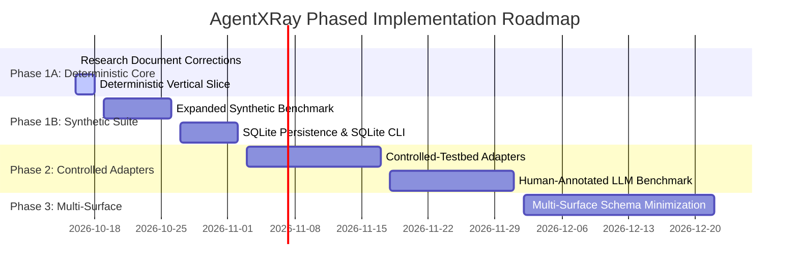

# Technical Architecture and Implementation Plan

> **AgentXRay Phase 0/1A Technical Specification**  
> **Status:** Architecture Specification & Deterministic Prototype Plan  
> **Author:** Lead AI Research Engineer & Software Architect  

---

## 1. System Architecture and Component Decomposition

AgentXRay is architected around a strict separation between its **Core Experimentation Engine**, its **Input/Result Models**, its **Synthetic Benchmark Testbed**, and its **Reporting Layer**.

```
+---------------------------------------------------------------------------------------+
|                                    ACCESS MODES                                       |
|  +---------------------------------------+  +--------------------------------------+  |
|  |           Black-Box Mode              |  |        Controlled-Testbed Mode       |  |
|  | - Only external inputs/outputs probed |  | - Configurable inputs, schemas, and  |  |
|  | - Prompt perturbations only           |  |   mock environment returns           |  |
|  +---------------------------------------+  +--------------------------------------+  |
+------------------------------------------+--------------------------------------------+
                                           |
+------------------------------------------v--------------------------------------------+
|                             CORE EXPERIMENTATION ENGINE                               |
|  +---------------------------+  +-------------------------------+  +---------------+  |
|  |     Intervention Runner   |  |     Delta-Debug Minimizer     |  |   Baselines   |  |
|  | - Budget & timeout control|  | - 1-minimal subset discovery  |  | - Greedy      |  |
|  | - Deterministic execution |  | - Conservative backtracking   |  |   ablation    |  |
|  | - Seeded repeatability    |  | - Strict 1-minimality check   |  | - Seeded rand |  |
|  +-------------+-------------+  +---------------+---------------+  +-------+-------+  |
|                |                                |                          |          |
|  +-------------v--------------------------------v--------------------------v-------+  |
|  |                             Pydantic Domain Models                              |  |
|  |   ExperimentConfig | InputCase | TargetResult | ProbeTrial | FailureReport      |  |
|  +---------------------------------------------------------------------------------+  |
+------------------------------------------+--------------------------------------------+
                                           |
+------------------------------------------v--------------------------------------------+
|                            TARGET & BENCHMARK HARNESS                                 |
|  +---------------------------------------------------------------------------------+  |
|  | Synthetic Black-Box Target (Planted Ground Truth completely isolated from engine|  |
|  | Single-factor | Conjunctive multi-factor | Distractor cases | Null non-failure  |  |
|  +---------------------------------------------------------------------------------+  |
+------------------------------------------+--------------------------------------------+
                                           |
+------------------------------------------v--------------------------------------------+
|                                 REPORTING LAYER                                       |
|  +---------------------------------------+  +--------------------------------------+  |
|  |   Structured Machine JSON Report      |  |     Human-Readable Markdown Summary  |  |
|  +---------------------------------------+  +--------------------------------------+  |
+---------------------------------------------------------------------------------------+
```

### 1.1. Core Components (Phase 1A Vertical Slice)

1. **`models.py` (Validation & Boundary Types)**:
   * `ExperimentConfig`: Validates trial budget, timeout, seed, and target mode.
   * `InputCase`: Validated, immutable representation of an input configuration (list of structured tokens/fragments).
   * `TargetResult`: Observable binary failure outcome, output message, and optional error telemetry.
   * `ProbeTrial`: Immutable record of a single execution containing trial ID, parent trial ID, intervention applied, input variation, and result.
   * `DiscoveredCondition`: Isolated subset, verification status (1-minimal vs incomplete), and target call count.
   * `ExperimentReport`: Comprehensive structured summary of all trials, comparisons, and evaluator metrics.
2. **`runner.py` (Controlled Intervention Runner)**:
   * Manages trial budgets (max calls and wall-clock timeout).
   * Executes interventions deterministically.
   * Records every trial with unique IDs and causal parentage.
3. **`minimizer.py` (1-Minimal Delta Debugger)**:
   * Adapts Zeller's delta-debugging algorithm for discrete input representations.
   * Systematically subdivides and tests candidate subsets.
   * Runs an explicit **1-minimality verification check** ($\forall e \in c, c \setminus \{e\}$ does not fail) before claiming 1-minimality.
   * Explicitly avoids claiming global minimality.
   * Handles non-monotonic outcomes conservatively.
4. **`baselines.py` (Direct Algorithmic Baselines)**:
   * *Greedy Single-Element Ablation*: Sequentially removes one element at a time; stops when failure is lost.
   * *Seeded Random Candidate Search*: Samples random candidate subsets under the exact same trial budget.
5. **`benchmarks/synthetic/target.py` (Deterministic Black-Box Target)**:
   * Exposes only a standard `execute(input_case) -> TargetResult` method.
   * Plants single-factor, conjunctive multi-factor, distractor-heavy, and null failure rules.
   * **Ground truth is strictly isolated**: The probing algorithm has zero access to ground-truth rules, rule metadata, or internal evaluation code.
6. **`reporting.py` (Report Generation)**:
   * Emits machine-readable JSON and human-readable Markdown reports generated strictly from executed experiment data.

---

## 2. Technology Choices and Rationale

| Layer | Chosen Technology | Alternatives Evaluated | Rationale for Choice |
| :--- | :--- | :--- | :--- |
| **Language & Runtime** | **Python 3.13** (compatible with 3.12+) | Node.js, Go, Rust | Standard for AI research. Python 3.13 provides modern typing, pattern matching, and performance. |
| **Dependency Manager** | **uv** | Poetry, Pipenv, pip | Ultra-fast, standardized virtual environment and package resolver. |
| **Validation** | **Pydantic v2** | attrs, dataclasses | Strict boundary validation, immutable models, fast JSON serialization. |
| **Testing** | **pytest** | unittest | Standard modern test runner with clean fixtures and parametric testing. |
| **Persistence (Phase 1A)** | **In-memory & JSON file export** | SQLite, PostgreSQL | For the minimal deterministic slice, persistent SQLite is unnecessary overhead; JSON artifact export suffices. (SQLite deferred to Phase 1B). |

---

## 3. Handling AI Engineering Challenges in Phase 1A

### 3.1. Non-Determinism and Reproducibility
* In Phase 1A, all synthetic targets and baseline algorithms are deterministic.
* Any randomized search baselines accept a fixed integer `seed` in `ExperimentConfig` ensuring bit-for-bit reproducibility across test runs.

### 3.2. Budget and Resource Constraints
* `max_trials`: Enforces an integer cap on the total number of target evaluations.
* `timeout_seconds`: Enforces a wall-clock timeout.
* If either threshold is crossed, the runner halts and marks the search status as `budget_exhausted` or `timeout`, recording that 1-minimality was **not verified**.

### 3.3. Safe Execution and Zero Network Dependencies
* The engine makes **zero network calls**, uses no external APIs, and requires no API keys or database servers.
* Synthetic targets execute pure in-memory Python logic without invoking shell commands or file writes.

---

## 4. Repository Structure

```
AgentXRay/
├── pyproject.toml                   # Project metadata, dependencies, uv build
├── README.md                        # Project introduction and quickstart
├── src/
│   └── agentxray/
│       ├── __init__.py              # Package export
│       ├── models.py                # Validated Pydantic models (inputs, trials, reports)
│       ├── runner.py                # Intervention runner with budget and timeout enforcement
│       ├── minimizer.py             # 1-minimal delta debugging algorithm
│       ├── baselines.py             # Greedy ablation & seeded random search baselines
│       ├── reporting.py             # JSON and Markdown report generators
│       └── __main__.py              # CLI entry point (`python -m agentxray`)
├── benchmarks/
│   └── synthetic/
│       ├── __init__.py
│       ├── target.py                # Synthetic black-box target with planted rules
│       ├── ground_truth.py          # Ground-truth specifications (isolated from engine)
│       └── tasks.py                 # Standard benchmark task definitions (A, B, C, D)
├── tests/
│   ├── __init__.py
│   ├── test_models.py               # Pydantic schema validation tests
│   ├── test_runner.py               # Intervention runner & budget tests
│   ├── test_minimizer.py            # Delta debugging & 1-minimality tests
│   ├── test_baselines.py            # Baseline fairness and behavior tests
│   └── test_reporting.py            # JSON/Markdown generation tests
└── docs/
    ├── PRIOR_ART_REVIEW.md
    ├── RESEARCH_PROPOSAL.md
    ├── TECHNICAL_PLAN.md
    └── DECISIONS.md
```

---

## 5. Phased Implementation Roadmap



---

## 6. Definition of Done for Phase 1A

1. **Document Integrity**: Research documents no longer contain unsupported claims of novelty or ungrounded performance figures.
2. **Local Installation**: Package installs cleanly via `uv pip install -e .`.
3. **Execution Command**: Documented CLI command runs synthetic experiments locally without network access.
4. **Verifiable Reports**: Emits valid JSON and Markdown reports containing actual execution metrics.
5. **Comprehensive Tests**: pytest test suite covering models, runner, minimizer, baselines, and reports with all tests passing.
6. **Explicit Limitations**: Synthetic validation limitations explicitly stated in generated reports.
7. **Git Cleanliness**: No Git commits made; repository history preserved.
8. **Scope Discipline**: Zero implementation of future-phase features (no real-provider APIs, no MCP, no FastAPI, no Next.js).
