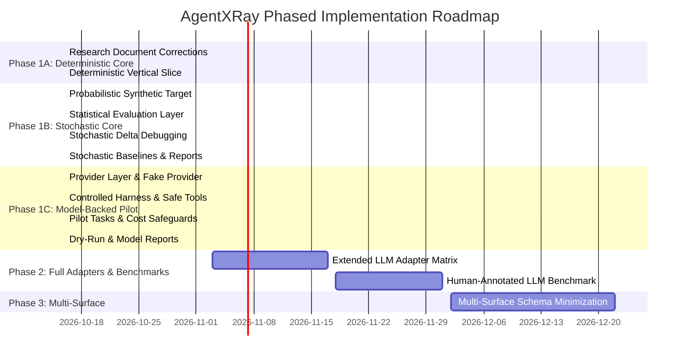

# Technical Architecture and Implementation Plan

> **AgentXRay Phase 0/1A Technical Specification**  
> **Status:** Architecture Specification & Deterministic Prototype Plan  
> **Author:** Lead AI Research Engineer & Software Architect  

---

## 1. System Architecture and Component Decomposition

AgentXRay is architected around a strict separation between its **Core Experimentation Engine**, its **Input/Result Models**, its **Synthetic Benchmark Testbed**, and its **Reporting Layer**.

```
+---------------------------------------------------------------------------------------+
|                                    ACCESS MODES                                       |
|  +---------------------------------------+  +--------------------------------------+  |
|  |           Black-Box Mode              |  |        Controlled-Testbed Mode       |  |
|  | - Only external inputs/outputs probed |  | - Configurable inputs, schemas, and  |  |
|  | - Prompt perturbations only           |  |   mock environment returns           |  |
|  +---------------------------------------+  +--------------------------------------+  |
+------------------------------------------+--------------------------------------------+
                                           |
+------------------------------------------v--------------------------------------------+
|                             CORE EXPERIMENTATION ENGINE                               |
|  +---------------------------+  +-------------------------------+  +---------------+  |
|  |     Intervention Runner   |  |     Delta-Debug Minimizer     |  |   Baselines   |  |
|  | - Budget & timeout control|  | - 1-minimal subset discovery  |  | - Greedy      |  |
|  | - Deterministic execution |  | - Conservative backtracking   |  |   ablation    |  |
|  | - Seeded repeatability    |  | - Strict 1-minimality check   |  | - Seeded rand |  |
|  +-------------+-------------+  +---------------+---------------+  +-------+-------+  |
|                |                                |                          |          |
|  +-------------v--------------------------------v--------------------------v-------+  |
|  |                             Pydantic Domain Models                              |  |
|  |   ExperimentConfig | InputCase | TargetResult | ProbeTrial | FailureReport      |  |
|  +---------------------------------------------------------------------------------+  |
+------------------------------------------+--------------------------------------------+
                                           |
+------------------------------------------v--------------------------------------------+
|                            TARGET & BENCHMARK HARNESS                                 |
|  +---------------------------------------------------------------------------------+  |
|  | Synthetic Black-Box Target (Planted Ground Truth completely isolated from engine|  |
|  | Single-factor | Conjunctive multi-factor | Distractor cases | Null non-failure  |  |
|  +---------------------------------------------------------------------------------+  |
+------------------------------------------+--------------------------------------------+
                                           |
+------------------------------------------v--------------------------------------------+
|                                 REPORTING LAYER                                       |
|  +---------------------------------------+  +--------------------------------------+  |
|  |   Structured Machine JSON Report      |  |     Human-Readable Markdown Summary  |  |
|  +---------------------------------------+  +--------------------------------------+  |
+---------------------------------------------------------------------------------------+
```

### 1.1. Core Components (Phase 1A Deterministic & Phase 1B Stochastic)

1. **`models.py` (Validation & Boundary Types)**:
   * `ExperimentConfig`: Validates trial budget, timeout, seed, and target mode.
   * `InputCase`: Validated, immutable representation of an input configuration (list of structured tokens/fragments).
   * `TargetResult`: Observable binary failure outcome, output message, and optional error telemetry.
   * `ProbeTrial`: Immutable record of a single execution containing trial ID, parent trial ID, intervention applied, input variation, and result.
   * `DiscoveredCondition`: Isolated subset, verification status (1-minimal vs incomplete), and target call count.
   * `CandidateEvaluation`: Multi-trial evaluation of a candidate subset with empirical failure rate and Wilson score confidence interval.
   * `StochasticDiscoveredCondition`: Isolated condition, Wilson CIs, single-element removal evaluations, and four-tier 1-minimality classification.
   * `StochasticBaselineComparison`: Benchmark outcome for stochastic greedy ablation and seeded random search.
   * `StochasticEvaluationResult` & `StochasticExperimentReport`: Comprehensive structured summary of all trials, comparisons, power estimates, and evaluator metrics.
2. **`statistics.py` (Statistical Evaluation Layer)**:
   * Wilson score intervals for single binomial proportions.
   * Newcombe hybrid score intervals for differences between two independent proportions.
   * Two-sample pooled z-tests with two-sided and one-sided p-values.
   * Benjamini-Hochberg False Discovery Rate (FDR) adjustment for multiple removal tests.
   * Statistical power estimation based on Cohen's arcsine transformation.
   * Zero third-party dependencies: implemented purely via standard library `math` and `statistics.NormalDist`.
3. **`runner.py` (Controlled Intervention Runner)**:
   * Manages trial budgets (max calls and wall-clock timeout).
   * Executes interventions deterministically.
   * Records every trial with unique IDs and causal parentage.
4. **`minimizer.py` & `stochastic_minimizer.py` (1-Minimal Delta Debuggers)**:
   * Deterministic ddmin: adapts Zeller's algorithm with hierarchical partitioning and explicit 1-minimality verification.
   * Stochastic ddmin: executes multi-trial candidate subset evaluations, tests single-element removals against failure threshold, applies Benjamini-Hochberg FDR correction, and classifies minimality into `statistically_supported`, `observed_only`, `inconclusive`, or `not_minimal`.
5. **`baselines.py` & `stochastic_baselines.py` (Direct Algorithmic Baselines)**:
   * *Greedy Single-Element Ablation*: Sequentially removes one element at a time; verifies minimality on remaining set.
   * *Seeded Random Candidate Search*: Samples random candidate subsets under the exact same trial budget.
6. **`benchmarks/synthetic/` (Target & Ground-Truth Harness)**:
   * Deterministic target and 4 tasks (`target.py`, `tasks.py`, `ground_truth.py`).
   * Stochastic target and 6 scenarios (`stochastic_target.py`, `stochastic_tasks.py`, `stochastic_ground_truth.py`): single-factor, conjunctive, distractor-heavy, null, non-monotonic, and weak-signal.
   * **Ground truth is strictly isolated**: The probing algorithms have zero access to ground-truth rules, rule metadata, or internal evaluation code.
7. **`reporting.py` (Report Generation)**:
   * Emits machine-readable JSON and human-readable Markdown reports for deterministic, stochastic, and model pilot benchmarks.
8. **`providers/` (Provider Abstraction Layer)**:
   * `base.py`: Protocol definitions (`ModelProvider`), message types (`Message`), tool schemas (`ToolDefinition`), response objects (`ModelResponse`, `ToolCall`), usage metadata (`UsageMetadata`), and provider exceptions.
   * `fake.py`: `FakeProvider` for zero-cost, hermetic testing with programmable responses, multi-turn tool calling, and simulated failure patterns.
   * `openai_adapter.py`: Zero-dependency OpenAI REST adapter implemented via standard library `urllib.request`, automatic token secret redaction (`_redact_secrets`), and pricing registry (`gpt-4o-mini`, `gpt-4o`).
9. **`agent_harness/` (Controlled Agent Execution Environment)**:
   * `tools.py`: Hermetic mock tools (`safe_calculator` evaluated via standard library AST parsing, `mock_database_lookup`, `mock_unit_converter`) and dispatch environment. Zero filesystem or network access.
   * `cost_tracker.py`: Tracks model requests, tokens, and estimated spend; enforces hard stops (`max_model_requests`, `max_spend_usd`).
   * `evaluator.py`: `ToolCallingTaskEvaluator` assessing required tool invocation and response correctness purely from observable traces.
   * `agent.py`: `ControlledAgent` multi-turn loop generating `AgentExecutionTrace` telemetry.
   * `target.py`: `ModelBackedAgentTarget` implementing `execute(InputCase) -> TargetResult`.
10. **`benchmarks/model_pilot/` (Model-Backed Pilot Benchmark)**:
    * `tasks.py`: 3 pilot tasks (Baseline Control, Conflicting Prompt Constraint, Distractor-Heavy Field Override).
    * `ground_truth.py`: Isolated ground-truth specifications for post-hoc evaluation.
    * `runner.py`: Benchmark orchestrator and pre-flight dry-run engine (`dry_run_model_pilot`, `run_model_pilot_benchmark`).

---

## 2. Technology Choices and Rationale

| Layer | Chosen Technology | Alternatives Evaluated | Rationale for Choice |
| :--- | :--- | :--- | :--- |
| **Language & Runtime** | **Python 3.13** (compatible with 3.12+) | Node.js, Go, Rust | Standard for AI research. Python 3.13 provides modern typing, pattern matching, and performance. |
| **Dependency Manager** | **uv** | Poetry, Pipenv, pip | Ultra-fast, standardized virtual environment and package resolver. |
| **Validation** | **Pydantic v2** | attrs, dataclasses | Strict boundary validation, immutable models, fast JSON serialization. |
| **Testing** | **pytest** | unittest | Standard modern test runner with clean fixtures and parametric testing. |
| **Persistence (Phase 1A)** | **In-memory & JSON file export** | SQLite, PostgreSQL | For the minimal deterministic slice, persistent SQLite is unnecessary overhead; JSON artifact export suffices. (SQLite deferred to Phase 1B). |

---

## 3. Handling AI Engineering Challenges in Phase 1A

### 3.1. Non-Determinism and Reproducibility
* In Phase 1A, all synthetic targets and baseline algorithms are deterministic.
* Any randomized search baselines accept a fixed integer `seed` in `ExperimentConfig` ensuring bit-for-bit reproducibility across test runs.

### 3.2. Budget and Resource Constraints
* `max_trials`: Enforces an integer cap on the total number of target evaluations.
* `timeout_seconds`: Enforces a wall-clock timeout.
* If either threshold is crossed, the runner halts and marks the search status as `budget_exhausted` or `timeout`, recording that 1-minimality was **not verified**.

### 3.3. Safe Execution and Zero Network Dependencies
* The engine makes **zero network calls**, uses no external APIs, and requires no API keys or database servers.
* Synthetic targets execute pure in-memory Python logic without invoking shell commands or file writes.

---

## 4. Repository Structure

```
AgentXRay/
├── pyproject.toml                   # Project metadata, dependencies, uv build
├── README.md                        # Project introduction and quickstart
├── src/
│   └── agentxray/
│       ├── __init__.py              # Package export
│       ├── models.py                # Validated Pydantic models (inputs, trials, stochastic reports, pilot models)
│       ├── statistics.py            # Wilson score, Newcombe CIs, FDR correction, power estimation
│       ├── runner.py                # Intervention runner with budget and timeout enforcement
│       ├── minimizer.py             # Deterministic 1-minimal delta debugging algorithm
│       ├── stochastic_minimizer.py  # Probabilistic multi-trial delta debugging with FDR control
│       ├── baselines.py             # Deterministic greedy ablation & seeded random search
│       ├── stochastic_baselines.py  # Stochastic greedy ablation & seeded random search
│       ├── reporting.py             # Deterministic, stochastic, and model pilot report generators
│       ├── audit.py                 # Multi-seed audit runner and comparative uncertainty reporter
│       ├── providers/               # Provider abstraction layer
│       │   ├── __init__.py
│       │   ├── base.py              # ModelProvider protocol, message and tool call types
│       │   ├── fake.py              # Hermetic FakeProvider for testing and dry runs
│       │   └── openai_adapter.py    # Zero-dependency OpenAI REST adapter with secret redaction
│       ├── agent_harness/           # Controlled agent harness
│       │   ├── __init__.py
│       │   ├── tools.py             # Hermetic mock tools with AST safe evaluation
│       │   ├── cost_tracker.py      # Hard spend and request limits
│       │   ├── evaluator.py         # Observable trace evaluator
│       │   ├── agent.py             # Controlled multi-turn agent loop
│       │   └── target.py            # ModelBackedAgentTarget adapter
│       └── __main__.py              # CLI entry point (`agentxray` / `python -m agentxray`)
├── benchmarks/
│   ├── synthetic/
│   │   ├── __init__.py
│   │   ├── target.py                # Deterministic synthetic black-box target
│   │   ├── ground_truth.py          # Deterministic ground-truth specifications (isolated)
│   │   ├── tasks.py                 # Deterministic benchmark tasks
│   │   ├── stochastic_target.py     # Probabilistic black-box target with isolated PRNG
│   │   ├── stochastic_ground_truth.py # Stochastic ground-truth specifications (isolated)
│   │   └── stochastic_tasks.py      # 6 stochastic benchmark tasks (single, conj, dist, null, non-mono, weak)
│   └── model_pilot/
│       ├── __init__.py
│       ├── ground_truth.py          # Isolated model pilot ground-truth specifications
│       ├── tasks.py                 # 3 pilot tasks (Control, Conflicting Prompt, Field Override)
│       └── runner.py                # Model pilot benchmark runner and pre-flight dry run
├── tests/
│   ├── __init__.py
│   ├── test_models.py               # Pydantic schema validation tests
│   ├── test_statistics.py           # Wilson, Newcombe, BH, Fisher, power estimation tests
│   ├── test_runner.py               # Intervention runner & budget tests
│   ├── test_minimizer.py            # Deterministic delta debugging tests
│   ├── test_stochastic_minimizer.py # Stochastic delta debugging & minimality tests
│   ├── test_baselines.py            # Deterministic baseline tests
│   ├── test_stochastic_baselines.py # Stochastic baseline tests
│   ├── test_stochastic_target.py    # Probabilistic target tests
│   ├── test_isolation.py            # Ground-truth isolation tests
│   ├── test_reporting.py            # Deterministic reporting tests
│   ├── test_stochastic_reporting.py # Stochastic reporting tests
│   ├── test_audit.py                # Multi-seed audit and reporting tests
│   ├── test_providers.py            # Provider abstraction and secret redaction tests
│   └── test_model_harness.py        # Mock tools, cost tracker, agent, and pilot runner tests
└── docs/
    ├── PRIOR_ART_REVIEW.md
    ├── RESEARCH_PROPOSAL.md
    ├── TECHNICAL_PLAN.md
    └── DECISIONS.md
```

---

## 5. Phased Implementation Roadmap



---

## 6. Definition of Done for Phase 1A

1. **Document Integrity**: Research documents no longer contain unsupported claims of novelty or ungrounded performance figures.
2. **Local Installation**: Package installs cleanly via `uv pip install -e .`.
3. **Execution Command**: Documented CLI command runs synthetic experiments locally without network access.
4. **Verifiable Reports**: Emits valid JSON and Markdown reports containing actual execution metrics.
5. **Comprehensive Tests**: pytest test suite covering models, runner, minimizer, baselines, and reports with all tests passing.
6. **Explicit Limitations**: Synthetic validation limitations explicitly stated in generated reports.
7. **Git Cleanliness**: No Git commits made; repository history preserved.
8. **Scope Discipline**: Zero implementation of future-phase features (no real-provider APIs, no MCP, no FastAPI, no Next.js).
