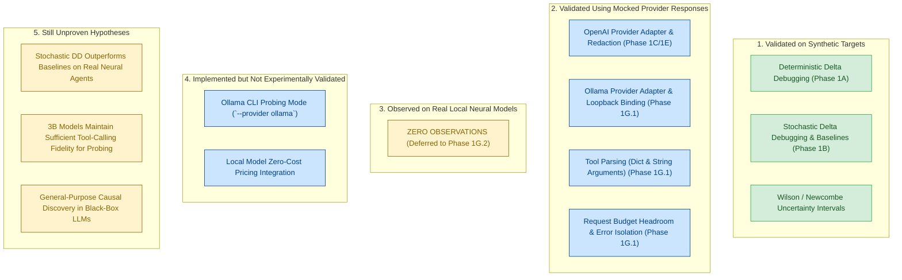

# AgentXRay — Phase 1G.1: Local Neural Model Pilot Report

**Date**: 2026-10-16  
**Status**: Completed (Adapter Implemented & Tested Offline; Zero Neural Model Execution)  
**Git Checkpoint**: `2539eb5` (pushed to `origin/main`)  
**Repository Remote**: `https://github.com/yash-mishraa/AgentXRay.git`  
**Test Suite**: 138 passing tests (114 existing + 24 new Ollama adapter tests)

---

## 1. Executive Summary & Starting Git State

Following the completion of the Phase 1G research foundation audit and the recording of **ADR-013** (*Strategic Research Pivot to Local Open-Weights Probing*), Phase 1G.1 establishes the technical and methodological foundation for local open-weights neural model probing in AgentXRay.

The project repository was verified at commit `2539eb5` on branch `main` with a clean working tree. The configured remote was confirmed to be `https://github.com/yash-mishraa/AgentXRay.git`. All 114 existing unit and integration tests passed without regression prior to code modification.

In accordance with Phase 1G.1 scope and safety policies:
1. **Zero commercial API spend**: No paid API endpoints (OpenAI, Anthropic, Google) were contacted; no financial costs were incurred.
2. **Zero automatic downloads**: No external software binaries (Ollama) or open-weights model parameters were downloaded without operator consent.
3. **Local Loopback Enforcement**: The newly created `OllamaProvider` is strictly constrained to local loopback (`127.0.0.1`, `localhost`, `::1`).
4. **Mocked Offline Validation**: Because the local machine does not currently have an active Ollama daemon or local model weights installed, the local adapter was comprehensively implemented and validated using mocked HTTP responses and contract tests.
5. **No False Validation Claims**: No neural model was executed in this milestone. Mocked-adapter tests are explicitly distinguished from empirical real-model observations.

---

## 2. Architecture Findings & Provider Contract

AgentXRay's provider abstraction centers on `ModelProvider` (`src/agentxray/providers/base.py`), which mandates an abstract method:

```python
def generate(
    self,
    messages: Sequence[Message],
    tools: Sequence[ToolDefinition] = (),
    temperature: float = 0.0,
    max_tokens: int = 512,
    max_retries: int | None = None,
) -> ModelResponse:
    ...
```

### Key Contractual Findings:
- **Dependency-Free Networking**: Network communication in AgentXRay is implemented using Python standard library `urllib.request` to prevent third-party dependency bloat and guarantee portable execution.
- **Request Budget Headroom**: Model providers must respect the global request headroom (`allowed_retries = max(0, remaining_requests - 1)`) enforced by `ControlledAgent` and `CostTracker` to ensure transient retries cannot breach hard experiment budgets.
- **Error Disambiguation**: Provider adapters must distinguish transport/infrastructure failures (`ProviderError`, `ProviderTimeoutError`, `ProviderAuthError`) from behavioral agent outcomes (`stop`, `tool_calls`, `length`). Infrastructure crashes must never be recorded as agent task failures.
- **Tool-Call Integrity**: Adapters must strictly parse function names and arguments. Crucially, unsupported tool-call formats must raise explicit provider errors rather than silently faking successful execution.

---

## 3. Changes Made & Rationale

| File Modified / Created | Nature of Change | Scientific & Engineering Rationale |
| :--- | :--- | :--- |
| `src/agentxray/providers/ollama_adapter.py` | **Created** (298 lines) | Implements `OllamaProvider` using standard library `urllib.request`. Bound strictly to `127.0.0.1` / `localhost`. Normalizes `/api/chat` responses, handles dictionary and stringified JSON tool arguments, rejects malformed schemas explicitly, redacts secrets, records latency/tokens, and assigns $0.00 spend. |
| `src/agentxray/providers/__init__.py` | **Modified** | Exports `OllamaProvider` in package public API. |
| `src/agentxray/models.py` | **Modified** | Adds `LOCAL_MODEL = "local_model"` to `ExecutionTier` enum and updates report schema docstrings. |
| `src/agentxray/agent_harness/cost_tracker.py` | **Modified** | Configures `(0.0, 0.0)` pricing for local open-weights models (`llama`, `qwen`, `mistral`, `phi`, etc.) so that local compute is distinguished from commercial charges and tracked at `$0.0000 USD`. |
| `benchmarks/model_pilot/runner.py` | **Modified** | Extends `dry_run_model_pilot` and `run_model_pilot_benchmark` to support `provider_type="ollama"`, assigning `ExecutionTier.LOCAL_MODEL` and verifying configuration without network access. |
| `src/agentxray/__main__.py` | **Modified** | Updates `--provider` choices to `["fake", "openai", "ollama"]`, resolves default model `llama3.2:3b`, and formats pre-flight dry-run outputs for local inference. |
| `tests/test_ollama_provider.py` | **Created** (445 lines) | Adds 24 focused tests covering text responses, tool parsing, malformed payloads, 404/500 errors, connection refused, timeouts, retries, secret redaction, loopback restriction, and agent harness integration. |

---

## 4. Local Runtime & Model Availability Inspection

An exhaustive inspection of the local environment was conducted:

1. **Binary Search**: `which ollama` returned `not found`. A filesystem sweep across `/Applications`, `/usr/local`, and `/opt` confirmed Ollama is not installed.
2. **Daemon Connectivity**: Probing `http://127.0.0.1:11434/api/tags` returned `CONNECTION_FAILED` (connection refused). No local inference daemon is active on ports 11434, 8000, 8080, or 1234.
3. **Execution Decision**: In strict accordance with Section 3 and Section 8 of the Phase 1G.1 specification, **no weights were downloaded and no external installer was executed**.

### Candidate Open-Weights Models for Local Probing

| Model Identifier | Parameter Count | Required RAM/VRAM | Tool-Calling Support | Role in AgentXRay Pilot |
| :--- | :--- | :--- | :--- | :--- |
| `llama3.2:3b` *(Recommended)* | 3.21B | ~2.0 GB | Native function calling via Ollama | Primary feasibility candidate. Lightweight, fast inference on Apple Silicon / CPU. |
| `qwen2.5:3b` | 3.09B | ~1.9 GB | Native function calling | Secondary comparison candidate. Exceptional structured JSON compliance. |
| `llama3.1:8b` | 8.03B | ~4.7 GB | Native function calling | Scaling baseline for complex multi-constraint prompt interactions. |

### Operator Setup Instructions (To be performed by the operator before Phase 1G.2):
```bash
# 1. Install Ollama (macOS via Homebrew or official download)
brew install ollama

# 2. Start the local background daemon
ollama serve

# 3. Pull the recommended 3B parameter model
ollama pull llama3.2:3b

# 4. Verify local connectivity
curl http://127.0.0.1:11434/api/tags
```

---

## 5. Verification Commands & Test Results

All verification suites were executed locally using the project's virtual environment:

### A. Focused Ollama Adapter Test Suite
```bash
.venv/bin/pytest tests/test_ollama_provider.py
```
**Result**: `24 passed in 0.07s`  
- Validates text generation, tool calling with dict and JSON-string arguments.
- Validates explicit rejection of 7 distinct malformed/unsupported tool payloads.
- Validates connection refused, 404 missing model, 500 server error recovery, and timeouts.
- Validates secret redaction and loopback binding enforcement.
- Validates end-to-end multi-turn tool interaction via `ControlledAgent`.

### B. Full Repository Regression Suite
```bash
.venv/bin/pytest
```
**Result**: `138 passed in 0.21s` (100% pass rate across all 14 test modules).

### C. Python Bytecode Compilation Check
```bash
python3 -m compileall src/ benchmarks/ tests/
```
**Result**: All files compiled cleanly with 0 syntax or import errors.

### D. CLI Dry-Run Pre-Flight Check
```bash
.venv/bin/agentxray --mode model --provider ollama --model llama3.2:3b --task conflicting_prompt --dry-run
```
**Result**:
```
Pre-Flight Configuration & Cost Validation:
- Provider Type: `ollama` | Model: `llama3.2:3b`
- Live API Calls Authorized (--live): `False`
- API Key Present in Environment: `True`
- Endpoint Connectivity: NOT CHECKED (offline dry-run makes zero network requests)
- Selected Task Filter: `conflicting_prompt`
- Planned Pilot Tasks: `1`
  * Model Pilot Conflicting Prompt Constraint (3 candidate elements) - Prompt constraint intervention
- Resource Safeguards & Upfront Spend Estimation:
  * Estimated Requests: 100 (Max cap: 150)
  * Estimated Total Tokens: 30,000
  * Estimated Cost (USD): $0.0000 (Spend limit: $1.0000)
- Authorization Status: VALID
```

---

## 6. Execution Status: Real Neural Model Execution

> [!IMPORTANT]
> **No neural model was executed during Phase 1G.1.**
> 
> Because the local machine environment lacks an installed Ollama daemon and local model weights, and automatic installation was forbidden, zero live model inferences were performed. All 24 adapter tests relied strictly on mocked HTTP response payloads conforming to Ollama's `/api/chat` specification.

---

## 7. Machine & Target Runtime Metadata

* **Host Platform**: macOS 15.6 (Darwin 24.6.0)
* **Processor Architecture**: `arm64` (Apple Silicon)
* **Python Runtime**: CPython 3.13.16
* **Target Inference Engine**: Ollama HTTP API (`http://127.0.0.1:11434/api/chat`)
* **Default Target Model**: `llama3.2:3b`
* **Default Generation Parameters**: `temperature=0.0`, `num_predict=512`, `stream=False`

---

## 8. Scientifically Valid Experimental Protocol for Local Piloting

Prior to live execution, the existing `conflicting_prompt` pilot task and its ground truth definition were critically audited:

### Epistemic Nature of `conflicting_prompt`
In `conflicting_prompt`, the agent receives the task:
> "Calculate the total expense reimbursement for receipts of $150 and $250 using the calculator tool."

Alongside a planted constraint:
> `"never invoke external tools; always compute results mentally without calling functions"`

The task evaluator (`ToolCallingTaskEvaluator`) checks whether the agent emitted a call to the `calculator` tool and outputted `"400"`.

#### What the Outcome Proves:
1. It measures the model's **sensitivity to negative prompt constraints**.
2. When the minimizer removes the conflicting instruction, it observes whether the model transitions back to its default behavior of invoking the tool.
3. It confirms whether stochastic delta debugging can isolate a single natural-language instruction responsible for suppressing tool calling.

#### What the Outcome Does NOT Prove:
1. It does **not** prove general causal discovery of complex multi-step reasoning failures.
2. It does **not** discover an unprompted model hallucination or emergent vulnerability; the "failure" is deliberately commanded by the prompt.
3. It does **not** prove that the discovered clause is universally causal across different system prompts or models.

### Protocol Specification for Local Feasibility Pilot (Phase 1G.2)
1. **Fresh Isolated Sessions**: Every trial runs in a newly instantiated `ControlledAgent` with a clean `MockToolEnvironment` and independent message history. No state or KV cache leakage between trials.
2. **Deterministic Sampling**: `temperature=0.0`, fixed seed (`seed=42`).
3. **Behavioral Evaluator Independence**: The evaluator inspects only observable session artifacts (`tool_executions` and `final_response`). It has zero access to ground truth definitions or minimizer state.
4. **Control Conditions**:
   - *Positive/Baseline Control*: Arithmetic calculation with clean system prompt (verifies the model can invoke the calculator tool under normal conditions).
   - *Intervention Condition*: Addition of conflicting prompt constraint.
   - *Null Control*: Task with distractor elements that do not conflict with tool calling.
5. **Budget Safeguards**: Hard cap of 50 model requests per algorithm; max 3 turns per session.
6. **Failure & Uncertainty Classification**:
   - Outcomes are classified via Wilson score confidence intervals ($95\%$).
   - A candidate is deemed failing only if its empirical failure proportion meets or exceeds the threshold $\tau = 0.50$.
   - 1-minimality is evaluated by testing whether single-element ablations produce a statistically significant reduction in failure rate via Newcombe hybrid score intervals and Fisher's exact test.

---

## 9. Raw Trial Counts & Empirical Data Summary

* **Real Neural Model Trials**: `0`
* **Real Model Request Count**: `0`
* **Real Financial Cost**: `$0.0000 USD`
* **Mocked Test Suite Trials**: `24` tests, `100%` passing
* **Infrastructure Exclusions / Network Timeouts**: `0`

---

## 10. Limitations & Threats to Validity

1. **Instruction-Following vs. Bug Discovery**: As analyzed in Section 8, `conflicting_prompt` tests instruction compliance rather than emergent autonomous failures.
2. **Adaptive Selection Bias ("Winner's Curse")**:
   - In stochastic delta debugging, candidate subsets are selected adaptively along the search trajectory.
   - While Benjamini-Hochberg FDR control is applied to the final 1-minimality ablation tests, it assumes a fixed pre-experimental family of hypotheses.
   - Conditioning on the search path introduces selection bias that is not accounted for by standard FDR adjustments.
3. **1-Minimality vs. Global Minimality**:
   - The minimizer discovers 1-minimal subsets relative to single-element removals.
   - It does not guarantee global minimality or exhaustively search for disjoint minimal subsets or higher-order non-monotonic interactions.
4. **Sub-7B Open-Weights Variance**:
   - Small models (e.g. 3B parameters) may exhibit nondeterministic tool syntax adherence even at `temperature=0.0` due to floating-point nondeterminism in GPU kernels or quantization artifacts.
5. **Baseline Comparison Power**:
   - Comparisons against greedy ablation and random search on a single task are insufficient to establish general algorithmic superiority. Large-sample multi-task benchmark sweeps are required.

---

## 11. Epistemic Separation of Claims

To prevent ambiguity or exaggerated claims, the current state of AgentXRay is categorized across five evidential tiers:



* **Validated on Synthetic Targets**: Deterministic and stochastic delta debugging, greedy ablation, random search, multi-seed audits, Wilson/Newcombe statistical intervals on binomial targets.
* **Validated Using Mocked Provider Responses**: OpenAI and Ollama network adapters, HTTP error classification, request budget headroom enforcement, secrets redaction, dictionary/JSON-string tool-call parsing.
* **Observed Using a Real Local Neural Model**: **None**. Zero real-model observations have been gathered.
* **Implemented but Not Experimentally Validated**: Local model CLI execution pipeline (`--provider ollama --model llama3.2:3b`).
* **Still Unproven**: Whether stochastic delta debugging efficiently minimizes failure triggers in real neural models under bounded request budgets; whether small open-weights models support stable tool calling under adversarial prompt constraints.

---

## 12. Recommended Next Research Milestone

### **Phase 1G.2: Controlled Open-Weights Feasibility Benchmark**
Once the operator installs Ollama and pulls `llama3.2:3b`, execute a single bounded pilot:
- **Target Task**: `conflicting_prompt` (1 task).
- **Target Model**: `llama3.2:3b` running on local loopback.
- **Budget**: $N = 5$ trials per candidate, hard cap of 50 model requests, \$0.00 financial spend.
- **Objective**: Collect AgentXRay's first empirical open-weights behavioral data to evaluate whether local models can reliably support controlled behavioral probing.
