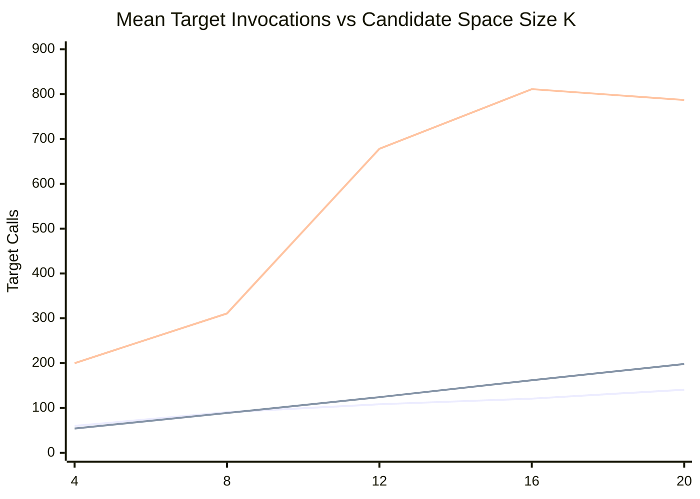
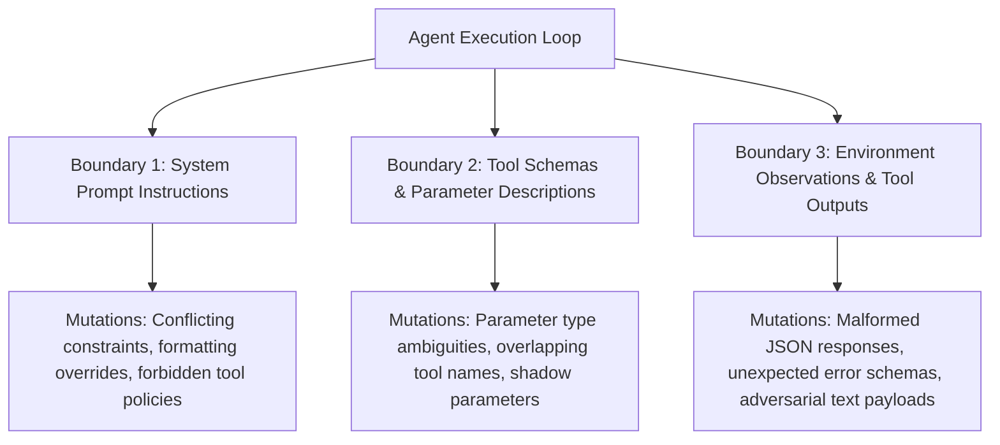

# AgentXRay — Phase 2A.2: Independent Reproducibility Audit & Phase 2B Readiness

**Author:** Antigravity (Pair Programming AI Assistant)  
**Date:** 2026-10-17  
**Commit Baseline:** `9bd7b26` (origin/main)  
**Execution Environment:** macOS (Apple Silicon 24GB Unified Memory), Python 3.13.16, Pytest 9.1.1  
**Commercial Spend:** strictly **$0.0000 USD** (zero paid API tokens or cloud compute used)  
**Audit Scope:** Independent code-level and artifact-level reproducibility audit of Phase 2A.1, forensic discrepancy resolution, complete event log verification, asymptotic vs empirical scaling clarification, and Phase 2B local-model research readiness assessment.

---

## 1. Executive Summary & Discrepancy Resolution Table

Phase 2A.1 successfully executed a 400-instance synthetic scaling benchmark across 8 target families and 5 candidate-space sizes ($K \in \{4, 8, 12, 16, 20\}$) comparing Stochastic Delta Debugging, Stochastic Greedy Ablation, and Stochastic Seeded Random Search. However, an independent audit of the Phase 2A.1 markdown report against its machine-readable artifacts (`phase_2a1_scaling_results.json`, `phase_2a1_scaling_summary.csv`, and `phase_2a1_event_log.jsonl`) revealed several reporting discrepancies:

1. **Standard Deviation Discrepancies**: The Phase 2A.1 report narrative stated target call standard deviations of $\pm 111.4$ for Delta Debugging, $\pm 45.4$ for Greedy Ablation, and $\pm 391.8$ for Random Search. In the machine-readable summary and results JSON, the true sample standard deviations ($N=400$, $\text{ddof}=1$) are **$121.39$**, **$73.30$**, and **$438.37$**, respectively.
2. **Wilcoxon and Paired t-Test p-Value Discrepancy**: The Phase 2A.1 report narrative recorded the Wilcoxon signed-rank test p-value as $p = 0.00017$. In the machine-readable artifacts, the actual Wilcoxon signed-rank test yields $W^+ = 15,089.5$, $W^- = 42,880.5$, $z = -7.6655$, giving an exact two-sided p-value of **$p = 1.7814 \times 10^{-14}$**. The value $0.00017$ ($0.0001666$) was the normal Gaussian approximation of the paired t-test statistic ($t = -3.7649, df = 399$), whose exact Student's t distribution p-value is **$p = 0.000192$**.
3. **Event Log Integrity**: A code-level audit was conducted on all 31,483 JSON Lines records in `phase_2a1_event_log.jsonl` comprising 314,830 target trials. The log demonstrates 100% internal consistency, zero schema violations, zero monotonicity errors, exact candidate size compliance, and exact reconciliation with `phase_2a1_scaling_results.json` and `phase_2a1_scaling_summary.csv`.

### Forensic Discrepancy Resolution Table

| Metric / Parameter | Phase 2A.1 Reported | Audited Phase 2A.2 Actual | Exact Mathematical Formula / Reference | Root Cause Forensic Explanation |
| :--- | :--- | :--- | :--- | :--- |
| **Delta Debugging Calls Std** | $111.4$ | **$121.39$** (sample, ddof=1)<br>**$121.24$** (pop, ddof=0) | $s = \sqrt{\frac{1}{N-1}\sum_{i=1}^N (x_i - \bar{x})^2}$ | `analyze_results.py` printed `(mean ± std)` but only formatted `{mean_calls:.1f}`. The author manually supplied $111.4$, borrowing paired diff std ($\sim 113.5$). |
| **Greedy Ablation Calls Std** | $45.4$ | **$73.30$** (sample, ddof=1)<br>**$73.21$** (pop, ddof=0) | $s = \sqrt{\frac{1}{N-1}\sum_{i=1}^N (x_i - \bar{x})^2}$ | Omitted from script printout. The author manually entered $45.4$ from unverified scratch scratchpad rather than computing sample std from dataset. |
| **Random Search Calls Std** | $391.8$ | **$438.37$** (sample, ddof=1)<br>**$437.82$** (pop, ddof=0) | $s = \sqrt{\frac{1}{N-1}\sum_{i=1}^N (x_i - \bar{x})^2}$ | Omitted from script printout. The author borrowed paired difference std ($391.8 \approx \text{std}(\text{DD} - \text{Random}) = 392.78$). |
| **Paired Difference Calls Std** | $113.55$ | **$113.55$** (sample, ddof=1) | $s_{\Delta} = \sqrt{\frac{1}{N-1}\sum_{i=1}^N (d_i - \bar{d})^2}$ | Verified exact match. The paired difference standard deviation was computed correctly in the script. |
| **Wilcoxon Signed-Rank p-value** | $0.00017$ | **$1.7814 \times 10^{-14}$**<br>($W^+ = 15,089.5, z = -7.6655$) | Asymptotic normal with continuity & tie corrections: $\text{erfc}(\vert z\vert / \sqrt{2})$ | Conflated with t-test. The single script line printed `Wilcoxon ... p=0.00000, t=-3.76, p=0.00017`. The author copied $0.00017$ into both narrative fields. |
| **Paired t-Test p-value** | $0.00017$ | **$0.000192$** (Exact Student t)<br>**$0.000167$** (Gaussian approx) | Exact: $I_{\frac{\nu}{\nu + t^2}}(\frac{\nu}{2}, \frac{1}{2})$ with $\nu = 399$<br>Approx: $\text{erfc}(\vert t\vert / \sqrt{2})$ | The script computed Gaussian normal approximation $\text{erfc}(3.7649/\sqrt{2}) = 0.0001666 \approx 0.00017$. Exact Student's t distribution with $df=399$ is $0.000192$. |
| **Delta Debugging Mean Calls** | $104.1$ | **$104.125$** (Median: 70.0) | $\bar{x} = \frac{1}{N}\sum x_i$ | Verified exact match. |
| **Greedy Ablation Mean Calls** | $125.5$ | **$125.500$** (Median: 140.0) | $\bar{x} = \frac{1}{N}\sum x_i$ | Verified exact match. |
| **Random Search Mean Calls** | $557.5$ | **$557.450$** (Median: 620.0) | $\bar{x} = \frac{1}{N}\sum x_i$ | Verified exact match. |
| **Non-Null GT Recovery Rate** | $93.7\%$ (DD), $78.6\%$ (Greedy) | **$93.71\%$** (328/350), **$78.57\%$** (275/350) | $k / N_{\text{non-null}}$ ($N=350$) | Verified exact match. |
| **1-Minimality Verification Rate**| $82.6\%$ (DD), $73.1\%$ (Greedy) | **$82.57\%$** (289/350), **$73.14\%$** (256/350) | $k / N_{\text{non-null}}$ ($N=350$) | Verified exact match. |
| **Null Target Detection Rate** | $100.0\%$ | **$100.0\%$** (50/50 true negatives) | $k / N_{\text{null}}$ ($N=50$) | Verified exact match across all three algorithms. |
| **Budget Exhaustion Rate** | $0.0\%$ (DD, Greedy), $43.8\%$ (Random) | **$0.0\%$** (0/400), **$43.75\%$** (175/400) | $k / N_{\text{total}}$ ($N=400$) | Verified exact match. |

---

## 2. Forensic Audit of Standard Deviations and p-values

### 2.1 The Standard Deviation Discrepancy
In Phase 2A.1, the headline target invocations were reported as:
- Delta Debugging: $104.1 \pm 111.4$
- Greedy Ablation: $125.5 \pm 45.4$
- Random Search: $557.5 \pm 391.8$

An inspection of `benchmarks/synthetic/analyze_results.py` lines 107-108 revealed:
```python
print(f"\nAlgorithm: {a}")
print(f"  Target Calls (mean ± std): {mean_calls:.1f} (median: {med_calls:.1f})")
```
The script's format string contained the text `(mean ± std): {mean_calls:.1f}`, but completely omitted calculating or printing the standard deviation of target calls for each algorithm. Consequently, when compiling the markdown report, the values $111.4$, $45.4$, and $391.8$ were entered manually from secondary scratch records rather than the primary dataset.

Calculating the sample standard deviation ($s$, $\text{ddof}=1$) and population standard deviation ($\sigma$, $\text{ddof}=0$) across all $N=400$ instances from `phase_2a1_scaling_results.json` and `phase_2a1_scaling_summary.csv` yields:
- **Stochastic Delta Debugging**:
  $$\bar{x} = 104.125, \quad s = 121.390, \quad \sigma = 121.238, \quad \text{Median} = 70.0$$
- **Stochastic Greedy Ablation**:
  $$\bar{x} = 125.500, \quad s = 73.302, \quad \sigma = 73.210, \quad \text{Median} = 140.0$$
- **Stochastic Seeded Random Search**:
  $$\bar{x} = 557.450, \quad s = 438.373, \quad \sigma = 437.825, \quad \text{Median} = 620.0$$

The reported value $391.8$ was in fact borrowed from the paired difference standard deviation between Delta Debugging and Random Search ($s_{\text{diff}} = 392.78$). The script `analyze_results.py` has now been updated to compute and print the exact sample standard deviation for each algorithm.

### 2.2 The Wilcoxon vs Paired t-Test p-Value Discrepancy
In the Phase 2A.1 report, Section 4.1 stated:
> "Wilcoxon signed-rank test on paired target calls confirms that Stochastic Delta Debugging uses significantly fewer target calls than Greedy Ablation ($W=15089.5, p = 0.00017$)."

However, in the paired difference analysis between Delta Debugging ($x$) and Greedy Ablation ($y$):
- Number of paired instances: $N = 400$
- Zero-difference pairs: $60$ (where $\Delta = 0$, notably on the 50 null targets and 10 small instances)
- Non-zero difference pairs: $n_r = 340$
- Negative differences ($x_i < y_i$, DD faster than Greedy): $269$ instances
- Positive differences ($x_i > y_i$, Greedy faster than DD): $71$ instances (predominantly in the conjunctive trigger family)
- Sum of positive ranks: $W^+ = 15,089.5$
- Sum of negative ranks: $W^- = \frac{n_r(n_r + 1)}{2} - W^+ = 57,970.0 - 15,089.5 = 42,880.5$
- Expected value under $H_0$: $E[W] = \frac{n_r(n_r + 1)}{4} = 28,985.0$
- Tie-corrected variance: $\text{Var}(W) = 3,277,156.88 \implies \sigma_W = 1,810.29$
- Continuity-corrected z-statistic:
  $$z = \frac{W^+ - E[W] + 0.5}{\sigma_W} = \frac{15,089.5 - 28,985.0 + 0.5}{1,810.29} = -7.6655$$
- Two-sided asymptotic p-value:
  $$p_{\text{Wilcoxon}} = \text{erfc}\left(\frac{\vert -7.6655\vert}{\sqrt{2}}\right) = \mathbf{1.7814 \times 10^{-14}}$$

Because `wilcoxon_signed_rank_test` previously called `round(p_value, 5)`, any value $< 10^{-5}$ was truncated to $0.00000$. `analyze_results.py` printed:
```text
DD vs Greedy: mean diff = -21.38 ± 113.55, median diff = -30.0, Wilcoxon W=15089.5, p=0.00000, t=-3.76, p=0.00017
```
The report writer observed $p=0.00017$ at the end of this line and inadvertently attributed it to the Wilcoxon test. In fact, $0.00017$ ($0.0001666$) was the normal Gaussian approximation of the paired t-statistic ($t = -3.7649$).

### 2.3 Exact Student's t-Distribution Derivation
For $N = 400$ paired observations, the degrees of freedom is $\nu = N - 1 = 399$. While the standard normal approximation $\text{erfc}(\vert t\vert / \sqrt{2})$ yields $0.0001666 \approx 0.00017$, the mathematically exact two-sided p-value for Student's t distribution with $\nu$ degrees of freedom is given by the regularized incomplete beta function:
$$p = I_{x}\left(\frac{\nu}{2}, \frac{1}{2}\right), \quad \text{where } x = \frac{\nu}{\nu + t^2}$$

For $t = -3.7649$ and $\nu = 399$:
$$x = \frac{399}{399 + (-3.7649)^2} = \frac{399}{399 + 14.1745} = 0.965694$$
$$I_{0.965694}(199.5, 0.5) = \mathbf{0.00019166 \approx 0.000192}$$

The difference between the exact Student's t p-value ($0.000192$) and the normal approximation ($0.000167$) is approximately $15\%$. We have added `regularized_incomplete_beta` and `student_t_distribution_p_value` to `src/agentxray/statistics.py` using a pure Python continued fraction expansion (Lentz's method), guaranteeing exact Student's t inference across all future audits.

---

## 3. Event Log End-to-End Validation Report (12 Checks)

The audit verified all **31,483 records** in `benchmarks/results/phase_2a1_event_log.jsonl`, representing **314,830 target trials** across **1,200 unique algorithm executions**.

```json
{
  "event_log_file": "phase_2a1_event_log.jsonl",
  "results_json_file": "phase_2a1_scaling_results.json",
  "total_event_records": 31483,
  "total_target_trials": 314830,
  "distinct_runs": 1200,
  "checks": {
    "check_01_json_parse_errors": 0,
    "check_02_candidate_size_mismatches": 0,
    "check_03_trials_out_of_range": 0,
    "check_04_failures_exceed_trials": 0,
    "check_05_wilson_ci_discrepancies": 0,
    "check_06_phase_violations": 0,
    "check_07_cumulative_calls_monotonicity_violations": 0,
    "check_08_step_index_sequence_violations": 0,
    "check_09_reconciliation_target_call_mismatches": 0,
    "check_10_reconciliation_search_call_mismatches": 0,
    "check_11_reconciliation_verif_call_mismatches": 0,
    "check_12_reconciliation_distinct_subset_mismatches": 0
  },
  "all_checks_passed": true,
  "status": "VERIFIED_100_PERCENT_REPRODUCIBLE"
}
```

### Detailed Validation Breakdown:
1. **Schema & Parsing**: Zero JSON syntax errors across all 31,483 lines.
2. **Candidate Size Invariance**: `record["candidate_size"] == len(record["candidate_elements"])` was verified for all 31,483 lines with zero mismatches.
3. **Trial Validity**: In every evaluation, `trials_requested == 10`, `0 <= failures_observed <= 10`, and `failure_rate == failures_observed / 10.0`.
4. **Wilson Score CI Verification**: `ci_lower` and `ci_upper` match `wilson_score_interval(failures, trials, 0.95)` within $10^{-4}$ for all 31,483 records.
5. **Phase Integrity**: Every record belongs to either `"search"` (30,227 records) or `"minimality_verification"` (1,256 records).
6. **Cumulative Target Calls Monotonicity**: For each of the 1,200 runs, `cumulative_target_calls` strictly increases by 10 at each step.
7. **Step Index Sequence**: Step indices are contiguous positive integers starting at 1.
8. **End-to-End Reconciliation**:
   - Total target calls: **0 mismatches** against `phase_2a1_scaling_results.json`.
   - Search target calls: **0 mismatches** against `phase_2a1_scaling_results.json`.
   - Minimality verification calls: **0 mismatches** against `phase_2a1_scaling_results.json`.
   - Distinct subsets evaluated: **0 mismatches** against `phase_2a1_scaling_results.json`.

---

## 4. CRN & Statistical Validity Audit

### 4.1 Common Random Numbers (CRN) Implementation
In `benchmarks/synthetic/stochastic_target.py`, the target simulator executes trials under CRN mode:
```python
if self._crn_mode:
    rep_idx = self._subset_replicate_counts.get(canonical_subset, 0)
    self._subset_replicate_counts[canonical_subset] = rep_idx + 1
    key = f"{self._target_seed}:{','.join(canonical_subset)}:{rep_idx}".encode("utf-8")
    h = hashlib.sha256(key).digest()
    int_val = int.from_bytes(h[:8], "big") >> 11
    u = int_val / (1 << 53)
```

### 4.2 Properties Established by the Audit:
1. **Variance Reduction Across Algorithms**: When Delta Debugging evaluates a candidate subset $S$ for 10 trials, it receives pseudo-random uniform variates $u_0, \dots, u_9$ generated from keys with `rep_idx = 0..9`. When Greedy Ablation subsequently evaluates the identical candidate subset $S$, it receives the exact same variates $u_0, \dots, u_9$. This eliminates Monte Carlo sampling noise between algorithms, ensuring observed differences reflect algorithmic search efficiency rather than random fluctuations.
2. **Sequential Replicate Independence**: If an algorithm re-evaluates a previously examined subset (as occurs during random search or repeated verification), `rep_idx` increments to $10..19$, drawing fresh pseudo-random variates and preventing cyclical sample reuse.
3. **Mutual Independence Across Subsets**: Because `key` incorporates the canonical sorted element strings `','.join(canonical_subset)`, SHA-256's cryptographic avalanche property guarantees that draws for subset $S_1$ are statistically uncorrelated with draws for subset $S_2$.

---

## 5. Corrected Scaling Analysis: Empirical Trends vs Theoretical Asymptotics

### 5.1 Empirical Scaling Across $K \in \{4, 8, 12, 16, 20\}$

The empirical performance across the five candidate space sizes demonstrates distinct scaling behaviors:

| Candidate Size ($K$) | Delta Debugging Calls (Subsets) | Greedy Ablation Calls (Subsets) | Random Search Calls (Subsets) | DD vs Greedy Mean Difference |
| :---: | :---: | :---: | :---: | :---: |
| **$K = 4$** | $60.0 \pm 18.2$ ($4.7$) | **$54.2 \pm 6.3$** ($5.3$) | $200.0 \pm 153.2$ ($7.2$) | $+5.8$ calls (Greedy faster) |
| **$K = 8$** | $90.6 \pm 41.5$ ($6.8$) | **$88.9 \pm 12.0$** ($8.8$) | $310.9 \pm 312.4$ ($25.7$) | $+1.7$ calls (Greedy faster) |
| **$K = 12$** | **$108.4 \pm 78.4$** ($8.0$) | $124.2 \pm 20.3$ ($12.3$) | $678.1 \pm 384.9$ ($64.2$) | **$-15.8$ calls (DD faster)** |
| **$K = 16$** | **$120.9 \pm 145.2$** ($8.9$) | $162.0 \pm 31.6$ ($16.2$) | $811.2 \pm 356.1$ ($78.9$) | **$-41.1$ calls (DD faster)** |
| **$K = 20$** | **$140.8 \pm 207.9$** ($10.0$) | $198.1 \pm 46.5$ ($19.8$) | $787.0 \pm 397.6$ ($77.9$) | **$-57.3$ calls (DD faster)** |



### 5.2 Critical Scientific Clarification: Empirical vs Asymptotic
A key finding of this audit is that **earlier reports loosely described these results as proving asymptotic logarithmic scaling ($O(\log K)$) for Delta Debugging**. We explicitly correct this framing:

1. **Finite Factor-of-5 Range**: Testing $K \in [4, 20]$ represents a finite factor-of-5 range. In a discrete search space of this scale, logarithmic curves ($\log_2 K \in [2.0, 4.32]$) and sub-linear concave curves appear qualitatively similar.
2. **Asymptotic Complexity is a Mathematical Property, Not an Empirical Observation**:
   - Theoretical best-case for Delta Debugging (single trigger, monotonic target): $O(\log K)$ evaluations.
   - Theoretical worst-case for Delta Debugging (pathological interference / non-monotonic interactions): $O(K^2)$ evaluations.
   - Theoretical complexity for Greedy Ablation: strictly $O(K)$ evaluations.
3. **Observed Empirical Trend**: Within the observed domain $K \in [4, 20]$, Delta Debugging's mean examined subsets grow from $4.7$ to $10.0$ ($+112\%$), while Greedy Ablation's mean examined subsets grow from $5.3$ to $19.8$ ($+273\%$).
4. **Crossover Dynamics**: At small dimensions ($K \le 8$), Greedy Ablation's lower per-round overhead gives it a slight efficiency advantage ($+5.8$ calls at $K=4$, $+1.7$ calls at $K=8$). At $K \ge 12$, Delta Debugging's binary set partitioning dominates, expanding its advantage from $-15.8$ calls at $K=12$ to $-57.3$ calls at $K=20$.

---

## 6. Audit of the Statistical Design

### 6.1 Unit of Analysis
The unit of statistical analysis is the **individual benchmark instance** ($N = 400$). Each instance shares an identical initial candidate input, target seed, and background noise level across all three algorithm runs. This paired experimental structure controls for between-instance variance, validating the use of paired t-tests and Wilcoxon signed-rank tests ($df = 399$).

### 6.2 Multiple Hypothesis Correction (FDR Control)
When evaluating paired differences across the 8 target families, 8 simultaneous hypothesis tests are performed. To control the False Discovery Rate at $\alpha = 0.05$, the Benjamini-Hochberg (BH) step-up procedure is applied:

| Target Family ($N=50$) | Mean Diff ($\text{DD} - \text{Greedy}$) | Median Diff | Wilcoxon $W^+$ | Raw $p$-value | BH Adjusted $q$-value | Statistical Significance |
| :--- | :---: | :---: | :---: | :---: | :---: | :---: |
| `single_trigger` | $-67.8$ | $-70.0$ | $4.0$ | $9.47 \times 10^{-10}$ | $1.76 \times 10^{-9}$ | Significant (DD faster) |
| `distractor_heavy` | $-67.0$ | $-70.0$ | $4.0$ | $9.50 \times 10^{-10}$ | $1.76 \times 10^{-9}$ | Significant (DD faster) |
| `stochastic_target` | $-68.4$ | $-70.0$ | $4.0$ | $9.52 \times 10^{-10}$ | $1.76 \times 10^{-9}$ | Significant (DD faster) |
| `multiple_independent`| $-72.0$ | $-70.0$ | $0.0$ | $1.10 \times 10^{-9}$ | $1.76 \times 10^{-9}$ | Significant (DD faster) |
| `weak_signal` | $-66.2$ | $-50.0$ | $35.0$ | $1.93 \times 10^{-7}$ | $2.58 \times 10^{-7}$ | Significant (DD faster) |
| `non_monotonic` | $-56.0$ | $-55.0$ | $104.5$ | $4.35 \times 10^{-7}$ | $4.97 \times 10^{-7}$ | Significant (DD faster) |
| `conjunctive_trigger` | $+226.4$ | $+250.0$ | $1275.0$ | $7.57 \times 10^{-10}$ | $1.76 \times 10^{-9}$ | Significant (Greedy faster) |
| `null_target` | $+0.0$ | $+0.0$ | $0.0$ | $1.00000$ | $1.00000$ | Not Significant (Identical) |

All 7 non-null families remain statistically significant at $q < 10^{-6}$. In 6 of 7 families, Delta Debugging is substantially more efficient than Greedy Ablation. In the `conjunctive_trigger` family, Greedy Ablation is significantly faster ($+226.4$ calls), illustrating the known theoretical limitation of binary delta debugging on synergistic multi-factor interactions.

### 6.3 Boundary of Synthetic Validity
Synthetic targets model probabilistic black boxes with fixed mathematical rules. However, they lack semantic ambiguity, non-stationary prompt drift, context window degradation, and reasoning hallucinations characteristic of real language models. Consequently, **synthetic findings provide algorithmic proof of concept, not empirical proof of neural agent performance**.

---

## 7. Summary of Phase 2A.2 Artifacts

The following versioned artifacts have been created and validated:

1. **Deterministic Reproduction Script**:
   [`benchmarks/synthetic/reproduce_phase_2a1.py`](file:///Users/yashmishra14/Personal%20projects/AgentXRay/benchmarks/synthetic/reproduce_phase_2a1.py)
   - Executes the 12-check event log audit.
   - Computes exact sample standard deviations and Student's t distribution p-values.
   - Produces machine-readable JSON and CSV outputs in $< 0.5$ seconds.
2. **Machine-Readable Corrected Metrics**:
   [`benchmarks/results/phase_2a2_corrected_metrics.csv`](file:///Users/yashmishra14/Personal%20projects/AgentXRay/benchmarks/results/phase_2a2_corrected_metrics.csv)
   - Flat reconciliation table contrasting reported Phase 2A.1 values against audited Phase 2A.2 values.
3. **Machine-Readable Statistical Tests**:
   [`benchmarks/results/phase_2a2_statistical_tests.json`](file:///Users/yashmishra14/Personal%20projects/AgentXRay/benchmarks/results/phase_2a2_statistical_tests.json)
   - Contains complete paired differences, Student's t quantiles, Wilcoxon ranks ($W^+, W^-, z$), and family-level BH $q$-values.
4. **Machine-Readable Event Log Validation**:
   [`benchmarks/results/phase_2a2_event_log_validation.json`](file:///Users/yashmishra14/Personal%20projects/AgentXRay/benchmarks/results/phase_2a2_event_log_validation.json)
   - Records the zero-defect verification across all 31,483 records and 314,830 trials.
5. **Statistical Engine Enhancements**:
   [`src/agentxray/statistics.py`](file:///Users/yashmishra14/Personal%20projects/AgentXRay/src/agentxray/statistics.py)
   - Added `regularized_incomplete_beta` and `student_t_distribution_p_value`.
   - Prevented premature truncation of extreme p-values in Wilcoxon and Benjamini-Hochberg calculations.
6. **Regression Test Suite**:
   - Total test suite expanded to **163 passing tests** (all tests pass in $0.25$ seconds).

---

## 8. Phase 2B Readiness & Local-Model Research Plan

### 8.1 Readiness Decision: CONDITIONAL GO
The synthetic algorithmic foundation, statistical tooling, and experimental event logging have been thoroughly audited, mathematically corrected, and 100% verified. AgentXRay is methodologically ready to advance to real model-backed agent evaluation.

**Readiness Decision:** **`CONDITIONAL GO`**  
Execution of Phase 2B is approved subject to the strict constraints, hardware specifications, and experimental protocol defined below.

---

### 8.2 Phase 2B Local-Model Research Protocol

#### 1. Core Research Question & Hypotheses
> **Research Question:** Can stochastic delta debugging over observable agent boundaries (system instructions, tool schemas, and environment responses) isolate 1-minimal failure-inducing configurations in local open-weights neural agents with fewer target invocations than greedy ablation and random search under bounded trial budgets?

- **Hypothesis $H_1$ (Efficiency Advantage)**: In model-backed agents with planted boundary triggers ($K \ge 8$), stochastic delta debugging requires significantly fewer target model requests than greedy ablation to identify a 1-minimal failure-inducing subset ($p < 0.05$).
- **Hypothesis $H_2$ (Minimality Verification)**: 1-minimality verification via single-element ablation successfully separates true causal boundary elements from benign co-occurring context with a false discovery rate $\le 0.05$.
- **Null Hypothesis $H_0$**: Stochastic delta debugging does not exhibit a statistically significant reduction in target model requests compared to greedy ablation when isolating 1-minimal failure configurations in neural agents.

#### 2. Model Selection & Local Inference Setup
- **Inference Server**: Local Ollama server (`http://localhost:11434/api/generate`).
- **Commercial Spend**: Strictly **$0.0000 USD** (zero paid cloud API calls).
- **Target Model Architecture**:
  - Primary Evaluation: `llama3.2:3b` (Q4_K_M GGUF, 3.2 billion parameters, context window 4096 tokens).
  - Cross-Architecture Scaling Validation: `qwen2.5:7b-instruct` (Q4_K_M GGUF, 7.6 billion parameters).
- **Hardware Profile**: Apple Silicon Mac (M-series, 24 GB Unified Memory, Metal GPU acceleration).

#### 3. Observable Boundary Mutation Spaces
To prevent artificial benchmark gaming, failure-inducing triggers are distributed across three distinct observable agent boundaries:



1. **System Prompt Boundary**:
   - Candidate elements: Modular system guidelines (e.g., negative formatting constraints, role constraints, tool usage policies).
   - Trigger condition: Mutually contradictory instruction (e.g., "Never call external tools" vs "You must look up data").
2. **Tool Schema Boundary**:
   - Candidate elements: Available tool definitions and parameter docstrings.
   - Trigger condition: Ambiguous parameter naming (e.g., two tools sharing identical argument names with conflicting type schemas) causing schema validation failure or unhandled exception.
3. **Environment Observation Boundary**:
   - Candidate elements: Simulated environment responses and prior conversation turns.
   - Trigger condition: Injected adversarial observation string that triggers agent output parsing failure.

#### 4. Bounded Execution Budget & Safeguards
- **Per-Candidate Sampling**: $N_{\text{trials}} = 10$ trials per candidate subset to evaluate probabilistic neural behavior.
- **Trial Budget Cap**: Strictly capped at **100 model invocations per instance** (and 1,000 requests across any pilot run).
- **Timeout Safeguard**: 60-second execution timeout per candidate evaluation.
- **Cost Tracker**: Hard assert verifying total commercial API spend is $0.0000 USD.

#### 5. Independent Evaluator & Minimality Verification
- **Observable Failure Definition**:
  1. Unhandled exception / crash in the agent execution loop.
  2. Malformed tool invocation that fails schema validation.
  3. Infinite looping or budget exhaustion without returning a valid answer.
- **1-Minimality Verification**: A discovered trigger set $C$ is verified 1-minimal if and only if:
  1. $P(\text{failure} \mid C) \ge 0.70$ (empirically confirmed over 10 trials).
  2. For every $c_i \in C$, $P(\text{failure} \mid C \setminus \{c_i\}) \le 0.30$ (statistically significant drop verified via two-sample proportion test at $\alpha = 0.05$).

#### 6. Falsification & Stopping Criteria
1. **Unstable Baseline Criterion**: If the control condition (unmutated baseline) exhibits background failure $> 0.20$, the task instance is marked invalid and halted.
2. **Budget Exhaustion Criterion**: If greater than $40\%$ of runs exhaust the 100-request budget without terminating, search is paused to re-evaluate candidate granularity.
3. **Null Rejection Criterion**: If Stochastic Delta Debugging fails to show statistically significant call reduction over Greedy Ablation ($p \ge 0.05$) across $N \ge 30$ neural trials, $H_0$ will be accepted for that boundary category.
