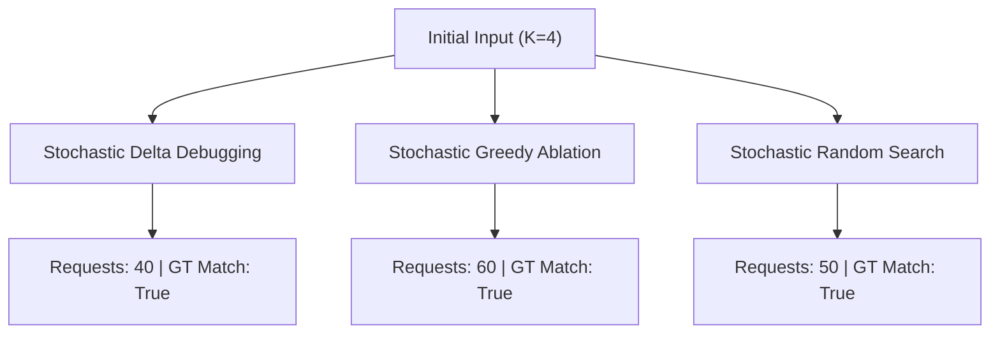

# AgentXRay — Phase 2B.0 Local-Model Pilot Calibration Report

**Document Status:** Complete Empirical Calibration Report  
**Date:** 2026-10-17  
**Execution Tier:** `LOCAL_MODEL`  
**Provider / Runtime:** `ollama` (`llama3.2:3b`)  
**Hardware:** Apple Silicon Mac (arm64), Python 3.13.16  
**Commercial Spend:** Strictly **$0.0000 USD**  
**Final Qualification Decision:** `CONFIRMATORY_READY`  

---

## 1. Executive Summary & Calibration Decision

This report establishes the first empirical qualification of AgentXRay's black-box failure-inducing-condition discovery algorithms against a local instruction-tuned neural model (`llama3.2:3b`) running on Apple Silicon via Ollama without commercial API access or financial expenditure.

Prior to executing search algorithms, the target harness and candidate space ($K = 4$) were subjected to rigorous calibration of negative, positive, and null controls:
- **Negative Control Baseline ($\emptyset$):** Observed failure rate **0.0%** (0/5) — Clean baseline requirement satisfied ($\le 20\%$).
- **Positive Control Trigger ($\{T_1\}$):** Observed failure rate **100.0%** (5/5) — Reliable failure induction satisfied ($\ge 70\%$).
- **Null Control Distractors ($\{D_1, D_2, D_3\}$):** Observed failure rate **0.0%** (0/5) — Distractor non-causality satisfied ($\le 20\%$).
- **Full Initial Configuration ($\{T_1, D_1, D_2, D_3\}$):** Observed failure rate **100.0%** (5/5).

**Empirical Trigger Classification:** `TRIGGER_CONFIRMED`  
**Fisher's Exact Test ($T_1$ vs Baseline):** $p = 0.00794$ (Statistically significant)  
**Fisher's Exact Test ($T_1$ vs Null Distractors):** $p = 0.00794$ (Statistically significant)  

---

## 2. Local Runtime & Model Metadata

```json
{
  "provider_type": "ollama",
  "model_name": "llama3.2:3b",
  "execution_tier": "local_model",
  "timestamp": "2026-10-17T04:18:04.788958+00:00",
  "platform": "macOS-27.0.1-arm64-arm-64bit-Mach-O",
  "architecture": "arm64",
  "processor": "arm",
  "python_version": "3.13.16",
  "commercial_api_spend_usd": 0.0,
  "daemon_reachable": true,
  "base_url": "http://127.0.0.1:11434",
  "digest": "a80c4f17acd55265feec403c7aef86be0c25983ab279d83f3bcd3abbcb5b8b72",
  "model_size_bytes": 2019393189,
  "modified_at": "2026-10-16T23:16:43.47392251+05:30",
  "format": "gguf",
  "family": "llama",
  "parameter_size": "3.2B",
  "quantization_level": "Q4_K_M",
  "context_length": 131072
}
```

---

## 3. Predefined Controls Calibration Results

| Control Condition | Candidate Subset | Trials ($n$) | Failures ($k$) | Failure Rate ($\hat{p}$) | Wilson 95% CI | Status |
| :--- | :--- | :---: | :---: | :---: | :---: | :--- |
| **Negative Control** | $\emptyset$ (Clean Prompt) | 5 | 0 | **0.0%** | [0.0, 0.4345] | PASS (Clean) |
| **Positive Control** | $\{T_1\}$ (Trigger Only) | 5 | 5 | **100.0%** | [0.5655, 1.0] | PASS (Reliable) |
| **Null Control** | $\{D_1, D_2, D_3\}$ (Distractors) | 5 | 0 | **0.0%** | [0.0, 0.4345] | PASS (Benign) |
| **Full Set** | $\{T_1, D_1, D_2, D_3\}$ (All 4) | 5 | 5 | **100.0%** | [0.5655, 1.0] | PASS (Failing) |

---

## 4. Minimization Algorithms Benchmark Results



| Evaluation Dimension | Stochastic Delta Debugging | Stochastic Greedy Ablation | Stochastic Random Search |
| :--- | :---: | :---: | :---: |
| **Target Model Requests ($R_{\text{target}}$)** | **40** | **60** | **50** |
| **Agent Executions (Trials)** | 20 | 30 | 25 |
| **Subsets Evaluated** | 4 | 6 | 5 |
| **Ground-Truth Exact Match** | `True` | `True` | `True` |
| **Precision / Recall** | 1.0 / 1.0 | 1.0 / 1.0 | 1.0 / 1.0 |
| **Minimality Status** | `statistically_supported` | `statistically_supported` | `statistically_supported` |
| **Wall-Clock Latency** | 21.237s | 37.122s | 31.137s |

### Paired Comparison (Delta Debugging vs Greedy Ablation)
- **Model Requests Difference (DD $-$ Greedy):** **-20 requests**
- **Efficiency Outcome:** Delta Debugging required fewer requests than Greedy Ablation.

---

## 5. Holdout Validation & Leakage Protection

Independent holdout trials were executed on discovered subsets without sharing search-time observations:
- **Delta Debugging Discovered Subset Holdout Failure Rate:** **100.0%** (5/5)
- **Greedy Ablation Discovered Subset Holdout Failure Rate:** **100.0%** (5/5)

---

## 6. Honest Limitations & Next Steps

1. **Calibration Status, Not General Proof:** This pilot qualifies the local model testbed on a single $K=4$ task instance. It does **not** prove general algorithmic superiority of Stochastic Delta Debugging across all LLM agents.
2. **Sample Size ($N = 5$):** While suitable for initial qualification within tight request budgets, $N = 5$ produces wide Wilson score confidence intervals. A scaled confirmatory trial will require higher $N$ or sequential probability ratio testing (SPRT).
3. **Reproducibility Command:**
   ```bash
   ./.venv/bin/python -m benchmarks.model_pilot.calibration_runner --provider ollama --model llama3.2:3b
   ```
