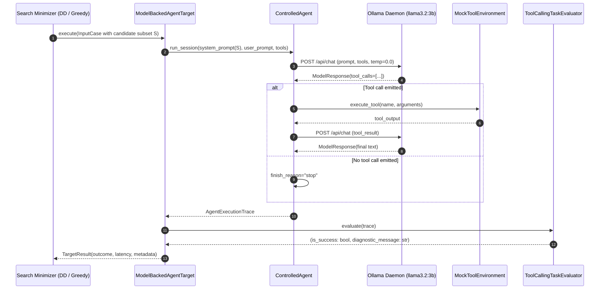

# AgentXRay — Phase 2B.0 Local-Model Pilot Protocol

**Document Version:** 1.0 (Frozen Pre-Pilot Protocol)  
**Author:** Antigravity (Pair Programming AI Assistant)  
**Date:** 2026-10-17  
**Commit Baseline:** `2e92142` (origin/main)  
**Target Runtime:** Local Ollama Daemon (`http://127.0.0.1:11434`)  
**Target Hardware:** Apple Silicon Mac (24 GB Unified Memory, 1 TB NVMe SSD)  
**Commercial API Spend:** Strictly **$0.0000 USD**  
**Protocol Status:** FROZEN BEFORE PILOT EXECUTION (No post-hoc modifications permitted)  

---

## 1. Scientific Research Question & Formal Hypotheses

### 1.1 The Core Research Question
> Can stochastic delta debugging over observable agent boundaries (system instructions, tool schemas, and environment responses) isolate 1-minimal failure-inducing configurations in local open-weights neural agents with fewer target model requests than greedy ablation, while maintaining acceptable ground-truth recovery and minimality-verification rates?

### 1.2 Formal Hypotheses
- **Primary Alternative Hypothesis ($H_1$ — Efficiency Advantage):**  
  In local model-backed tool-using agents subject to bounded evaluation budgets, Stochastic Delta Debugging requires fewer total target model inference requests than Stochastic Greedy Ablation to discover a 1-minimal failure-inducing configuration:
  $$E[\text{Requests}_{\text{DD}}] < E[\text{Requests}_{\text{Greedy}}]$$
  evaluated across paired task instances where a demonstrated failure trigger exists.
- **Secondary Hypothesis ($H_2$ — Statistical Minimality Discrimination):**  
  Empirical 1-minimality verification using single-element ablation and two-sample proportion score tests at significance level $\alpha = 0.05$ achieves a false discovery rate $\le 0.05$ on unmutated or non-causal candidate elements.
- **Null Hypothesis ($H_0$ — Equivalence / Non-Superiority):**  
  Stochastic Delta Debugging does not reduce the mean number of target model inference requests compared to Stochastic Greedy Ablation:
  $$E[\text{Requests}_{\text{DD}}] \ge E[\text{Requests}_{\text{Greedy}}]$$

### 1.3 Predefined Unit of Analysis & Falsification Criteria
- **Unit of Analysis:** The independent experimental instance (a tuple of model architecture, task prompt, tool environment, and candidate space evaluated under identical seed conditions).
- **Primary Comparison Baseline:** Stochastic Greedy Ablation under identical trial budgets and stopping criteria.
- **Evidence Counting Against the Hypothesis ($H_1$):**
  1. A paired difference test yielding $p \ge 0.05$ (failing to reject $H_0$).
  2. Observed mean requests where $\text{Requests}_{\text{DD}} \ge \text{Requests}_{\text{Greedy}}$.
  3. Ground-truth recovery rate of Delta Debugging falling below $60.0\%$ on calibrated targets.
  4. Budget exhaustion rate exceeding $40.0\%$ under the prespecified request cap.

> [!IMPORTANT]
> **No Synthetic Transfer Assumption:** Synthetic benchmark findings provide algorithmic proof-of-concept under stationary mathematical probability rules. They do **not** establish transfer to real neural agents, which exhibit context-dependent semantic interference, instruction fine-tuning priors, and non-stationary generation dynamics. Transfer must be empirically observed.

---

## 2. Target Agent Architecture & Failure Taxonomy

### 2.1 Agent Execution Loop
The target agent is an actual local neural agent executing through [`ControlledAgent`](file:///Users/yashmishra14/Personal%20projects/AgentXRay/src/agentxray/agent_harness/agent.py) and [`ModelBackedAgentTarget`](file:///Users/yashmishra14/Personal%20projects/AgentXRay/src/agentxray/agent_harness/target.py):
1. **Task Injection:** Receives base task instructions and the candidate subset of mutated boundary elements.
2. **Tool Schema Exposure:** Exposes standard JSON schema tool definitions to the local model.
3. **Model Generation Turn:** Invokes the local model via [`OllamaProvider`](file:///Users/yashmishra14/Personal%20projects/AgentXRay/src/agentxray/providers/ollama_adapter.py) with structured tool call parsing.
4. **Mock Tool Execution:** Tool invocations are dispatched to [`MockToolEnvironment`](file:///Users/yashmishra14/Personal%20projects/AgentXRay/src/agentxray/agent_harness/tools.py), returning deterministic outputs.
5. **Observability & Trace Capture:** Full message history, raw model outputs, parsed tool calls, tool outputs, latency, tokens, and errors are captured into an immutable [`AgentExecutionTrace`](file:///Users/yashmishra14/Personal%20projects/AgentXRay/src/agentxray/agent_harness/agent.py#L33-L49).
6. **Black-Box Evaluator:** An independent evaluator ([`ToolCallingTaskEvaluator`](file:///Users/yashmishra14/Personal%20projects/AgentXRay/src/agentxray/agent_harness/evaluator.py)) inspects the runtime trace and returns a binary outcome (`TargetOutcome.SUCCESS` or `TargetOutcome.FAILURE`).

### 2.2 Strict Taxonomy of Mutually Exclusive Failure Classes

To prevent conflation of infrastructure instability with agent behavioral bugs, failures are categorized into six mutually exclusive classes:

| Class Code | Failure Classification | Definition & Observable Criteria | Treatment in Minimization Algorithm |
| :--- | :--- | :--- | :--- |
| **`FAIL_BEHAVIOR`** | **Model-Behavior Failure** | Model refuses the task, emits non-compliant text, fails to execute required tool, or hallucinates irrelevant operations. | **Target Behavioral Failure** (Counted as failure event) |
| **`FAIL_SCHEMA`** | **Tool Schema Failure** | Model emits a malformed tool call whose parameters violate the tool's JSON schema (type mismatch, missing parameter). | **Target Behavioral Failure** (Counted as failure event) |
| **`FAIL_TOOL_EXEC`** | **Tool Execution Failure** | Model emits parameters that cause the mock tool environment to return an execution error (e.g. calculator syntax error). | **Target Behavioral Failure** (Counted as failure event) |
| **`FAIL_ORCHEST`** | **Agent Parsing Failure** | Orchestration framework fails to parse model output into a valid response or tool structure. | **Target Behavioral Failure** (Counted as failure event) |
| **`EXH_BUDGET`** | **Budget / Timeout Exhaustion** | Agent session exceeds turn limit ($T > 3$) or reaches per-instance request budget. | **Terminal Search State** (Search aborted, not marked behavioral failure) |
| **`ERR_INFRA`** | **Infrastructure Crash** | Local Ollama daemon unreachable, socket connection reset, out-of-memory crash, or HTTP 500. | **Infrastructure Error** (**NEVER** counted as target failure; raises exception or halts run) |

---

## 3. Candidate Interventions & Ground-Truth Strategy

### 3.1 Candidate Mutation Space ($K=4$)
To maintain statistical and computational feasibility during initial qualification, the candidate space is fixed at $K = 4$ modular elements. Every element is explicitly specified before execution:

1. **Trigger Candidate ($T_1$):** A prespecified instruction designed to induce observable behavioral or schema failure.
2. **Distractor 1 ($D_1$):** Stylistic formatting constraint (e.g. "format summary clearly").
3. **Distractor 2 ($D_2$):** Metadata tagging constraint (e.g. "include compliance reference code REF-2026").
4. **Distractor 3 ($D_3$):** Timing memo constraint (e.g. "append verification timestamp").

### 3.2 Exhaustive Characterization Feasibility
For $K = 4$, the power set contains exactly $2^4 = 16$ possible candidate configurations:
$$\mathcal{P}(C) = \{ \emptyset, \{T_1\}, \{D_1\}, \dots, \{T_1, D_1, D_2, D_3\} \}$$

Before executing minimization algorithms, an **Independent Exhaustive Characterization** will evaluate all 16 configurations across $N_{\text{char}} = 10$ trials each ($160$ model requests total).
- **Separation of Characterization Observations:** The 160 characterization observations are stored separately and are strictly isolated from the minimizers' search runtime.
- **Demonstrated Trigger Requirement:** An element $T_1$ is deemed an empirical failure trigger if and only if:
  $$P(\text{failure} \mid T_1 \in S) \ge 0.70 \quad \text{AND} \quad P(\text{failure} \mid T_1 \notin S) \le 0.20$$
  If a planted element fails to achieve this separation during exhaustive characterization, it is classified as **`TRIGGER_UNCONFIRMED`** and the task is marked **exploratory**. Search algorithms will not be reported as confirmatory tests against unconfirmed triggers.

### 3.3 Controls Specification
- **Negative Control / Baseline ($\emptyset$):** Unmutated base task prompt with standard calculator tool. Must exhibit $P(\text{failure}) \le 0.10$.
- **Positive Control ($\{T_1\}$):** Planted trigger alone. Must exhibit $P(\text{failure}) \ge 0.70$.
- **Null Control Instance:** An instance containing only benign distractors $\{D_1, D_2, D_3, D_4\}$ with no planted trigger. Must reproduce zero target failures.

---

## 4. Mathematical Budget & Statistical Feasibility Analysis

### 4.1 Granular Operational Definitions
To avoid unit confusion, the following definitions are strictly enforced:
- **Model Inference Request:** A single HTTP POST to `/api/chat` producing one model generation.
- **Complete Agent Execution:** A full multi-turn interaction satisfying user prompt to final answer (typically 1 to 2 model requests).
- **Trial:** One agent execution evaluated under a specific candidate subset configuration $S$.
- **Candidate Subset Evaluation:** A batch of $N_{\text{trials}}$ trials under the same subset $S$.
- **Algorithm Run:** A complete minimization execution from initial candidate set to final isolated minimal subset.
- **Experimental Instance:** A specific task configuration with fixed candidate elements and initial seed.

### 4.2 Budget Arithmetic & Upper Bounds
Given a hard budget cap of **100 model requests per algorithm run**:
- If each trial consumes 1 model request (tool invocation decision evaluated at Turn 1):
  - $N_{\text{trials}} = 10 \implies$ each candidate subset evaluation costs **10 requests**.
  - Budget cap permits at most **$\lfloor 100 / 10 \rfloor = 10$ candidate subset evaluations**.

#### Feasibility by Algorithm for $K = 4$:
1. **Stochastic Delta Debugging:**
   - Step 1: Initial set $\{T_1, D_1, D_2, D_3\}$ ($1$ subset $= 10$ requests).
   - Step 2: First split into 2 subsets of size 2: $\{T_1, D_1\}$ and $\{D_2, D_3\}$ ($2$ subsets $= 20$ requests).
   - Step 3: Second split of failing subset into 2 subsets of size 1: $\{T_1\}$ and $\{D_1\}$ ($2$ subsets $= 20$ requests).
   - Step 4: Verification of candidate $\{T_1\}$ against baseline $\emptyset$ ($1$ subset $= 10$ requests).
   - **Total Subsets Examined:** $6$ subsets = **$60$ model requests** $\le 100$ cap. **Mathematically Feasible.**
2. **Stochastic Greedy Ablation:**
   - Step 1: Initial set $\{T_1, D_1, D_2, D_3\}$ ($1$ subset $= 10$ requests).
   - Step 2: Single-element ablations: 4 subsets of size 3 ($4$ subsets $= 40$ requests).
   - Step 3: Verification of candidate $\{T_1\}$ against baseline $\emptyset$ ($1$ subset $= 10$ requests).
   - **Total Subsets Examined:** $6$ subsets = **$60$ model requests** $\le 100$ cap. **Mathematically Feasible.**
3. **Limitation for $K \ge 8$:**
   - For $K = 8$, Greedy Ablation evaluates $1 + 8 = 9$ subsets in Round 1 alone ($90$ requests). Any subsequent ablation rounds breach the 100-request cap.
   - **Conclusion:** A budget of 100 model requests is mathematically sound for $K = 4$, but cannot support $K \ge 8$ with $N_{\text{trials}} = 10$. Scaling beyond $K=4$ requires either adaptive sequential testing (SPRT) or scaling the request cap linearly with $K$.

### 4.3 Statistical Uncertainty of $N_{\text{trials}} = 10$
Evaluating Bernoulli trials with $N = 10$ produces wide uncertainty intervals:
- Observed $\hat{p} = 0.70$ ($7/10$ failures): Wilson 95% Score CI = $[0.3927, 0.8907]$.
- Observed $\hat{p} = 0.30$ ($3/10$ failures): Wilson 95% Score CI = $[0.1078, 0.6032]$.
- **Overlapping Confidence Intervals:** $[0.39, 0.89]$ overlaps $[0.11, 0.60]$ across $[0.39, 0.60]$.
- **Fisher's Exact Test:** Comparing $7/10$ vs $3/10$ yields a two-sided p-value of $p = 0.1789 > 0.05$ (not statistically significant).
- **Methodological Rule:** To declare a candidate statistically supported at $\alpha = 0.05$ with $N=10$, the observed contrast must achieve at least $8/10$ vs $2/10$ ($p = 0.0230$) or $7/10$ vs $1/10$ ($p = 0.0198$). Minimality decisions must report the exact two-sample score test p-value, not an unadjusted point-estimate heuristic.

---

## 5. Predefined Evaluation Metrics

The following metrics are frozen prior to running the pilot. The primary efficiency metric is fixed as **Target Model Requests**:

1. **Primary Efficiency Metric:** Total Target Model Requests ($R_{\text{target}}$) consumed by the algorithm run.
2. **Subsets Examined:** Count of distinct candidate configurations evaluated.
3. **Exact Ground-Truth Recovery:** Binary indicator whether discovered subset equals true minimal trigger ($C_{\text{discovered}} = T_{\text{true}}$).
4. **Partial Recovery:** Jaccard similarity $J = \frac{|C \cap T|}{|C \cup T|}$ between discovered and true trigger sets.
5. **Empirically Supported 1-Minimality:** Binary indicator whether candidate passes two-sample proportion score test at $\alpha = 0.05$ upon single-element removal.
6. **False Discoveries on Null Targets:** Discovery of non-empty trigger on an unmutated or distractor-only null task.
7. **Empirical Failure Reproduction Rate:** Sample failure proportion $\hat{p} = k / n$ on holdout confirmation trials.
8. **Wall-Clock Latency:** Total execution time in seconds.
9. **Budget Exhaustion Rate:** Percentage of runs terminating due to budget cap rather than algorithmic convergence.
10. **Infrastructure Failure Rate:** Proportion of trials aborted due to daemon disconnection or OOM errors.

---

## 6. Execution Protocol & Stopping Criteria

1. **Pre-flight Daemon Check:** Confirm Ollama daemon reachable and responsive at `http://127.0.0.1:11434`.
2. **Negative Control Baseline Run:** Execute $N = 10$ trials on unmutated baseline. If baseline failure $> 0.20$, **STOP** (target agent too noisy).
3. **Exhaustive Characterization Run:** Execute 16 candidate configurations ($N = 10$ trials each). Verify $T_1$ induces failure $\ge 0.70$ and ablations drop $\le 0.30$. If not satisfied, **STOP** (planted trigger unconfirmed).
4. **Minimization Execution:** Execute Stochastic Delta Debugging, Stochastic Greedy Ablation, and Stochastic Random Search on the characterized instance under identical random seed conditions.
5. **Holdout Confirmation:** Execute $N = 10$ independent validation trials on the discovered subset to confirm stability without search-time leakage.
6. **Final Classification:** Label the pilot outcome as `CONFIRMATORY_READY`, `EXPLORATORY_ONLY`, or `HARNESS_INADEQUATE`.
