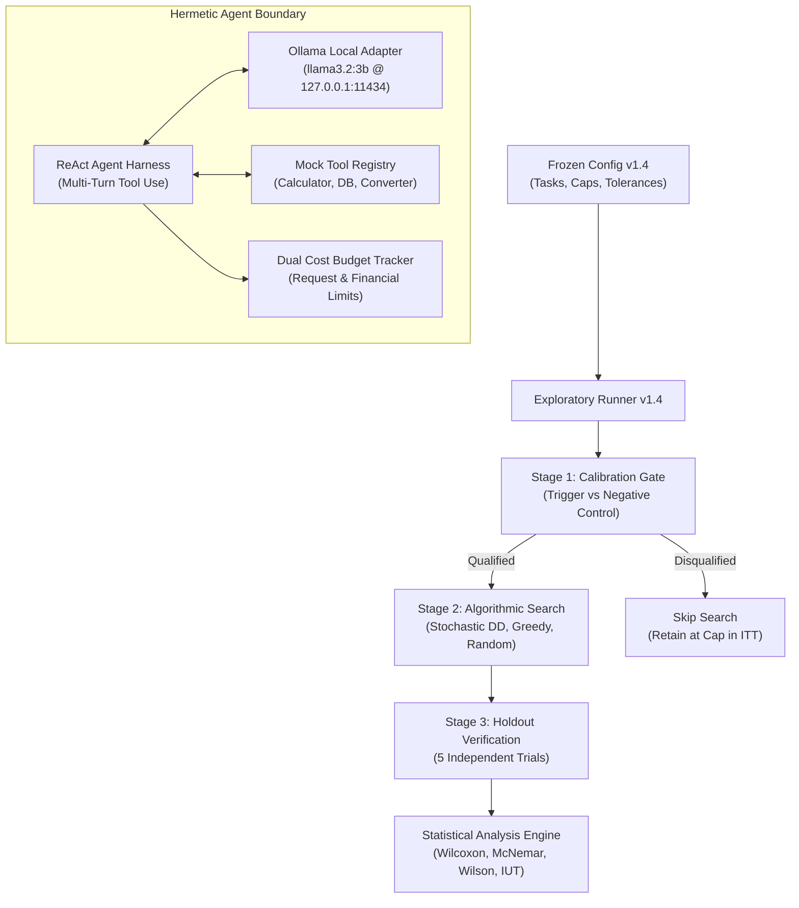

# A Black-Box Framework for Discovering Minimal Failure-Inducing Conditions in Tool-Using AI Agents

**Document Reference:** `docs/research/phase_3_1/phase_3_1_agentxray_research_report.md`  
**Date:** 2026-10-17  
**Version:** Phase 3.1 Corrected Successor Document  
**Target Repository:** `/Users/yashmishra14/Personal projects/AgentXRay`  
**Git Checkpoint:** HEAD at commit `62579fb` on branch `main`  
**Execution Reference:** Phase 2B.1 Exploratory Benchmark (`benchmarks/results/phase_2b1_5_execution/`)  
**Audit References:** 
- Phase 2B.1.6 Forensic Audit (`benchmarks/results/phase_2b1_6_audit/`)
- Phase 3.1 Scientific Integrity Audit (`docs/research/phase_3_1/phase_3_1_scientific_integrity_audit.md`)  
**Errata Reference:** `docs/research/phase_3_1/phase_3_1_errata_and_provenance.md`

---

## Abstract

As tool-using AI agents are increasingly deployed in autonomous software workflows, isolating the root causes of agent failures becomes challenging. Failures frequently depend on subtle interactions between system instructions, user inputs, external tool schemas, and environment state. Existing debugging techniques either require white-box access to internal execution traces and checkpoints (e.g., Causal Agent Replay, DoVer) or are restricted to deterministic, single-turn prompt string minimization (e.g., Amazon DD, DDOR). 

This paper presents **AgentXRay**, a reproducible black-box framework for discovering 1-minimal failure-inducing configurations across the observable boundary of tool-using agents. The framework formalizes stochastic delta debugging ($ddmin$) across multi-surface intervention spaces (prompt clauses, tool parameter schemas, and mock environment returns) under formal statistical uncertainty quantification (Wilson binomial score intervals, Newcombe hybrid difference intervals, and Intersection–Union Testing). Candidate 1-minimality is evaluated using the **Intersection–Union Principle (Berger 1982)**: a candidate is verified as 1-minimal if and only if every single-element deletion exhibits a statistically significant drop in failure rate via Fisher's exact test ($\alpha = 0.05$) while satisfying an empirical non-failure guard ($\hat{p} < 0.50$).

We report results from an authorized exploratory benchmark evaluating an open-weights agent backed by local `llama3.2:3b` across 16 preregistered task configurations ($K \in \{4, 8\}$). On qualified tool argument syntax mechanisms, Stochastic Delta Debugging achieved a **descriptive 43.8% reduction in model inference requests** compared to Stochastic Greedy Ablation (mean 45.0 vs 80.0 requests) while maintaining identical 100% trigger recovery. However, in a mechanism-level paired Wilcoxon signed-rank test across all $n=6$ preregistered mechanisms under an Intention-to-Treat design, the result ($p = 0.5000$) **failed to reject the null hypothesis**, as calibration dropouts reduced statistical power. Furthermore, empirical trials revealed critical divergence between statistical 1-minimality and true causal ground truth: on complex schema tasks and database null controls, prompt bloat and distractor interactions caused the algorithms to isolate statistically supported 1-minimal conditions that did not match the planted ground truth. We conclude that black-box minimization efficiently isolates reproducible operational failure modes, but statistical minimality alone cannot be conflated with semantic ground-truth fault identification in stochastic language models.

---

## 1. Introduction and Motivation

Tool-using language model agents integrate natural language reasoning with structured function calling to interact with databases, web services, and computational APIs. However, agents exhibit severe fragility: an agent may execute successfully on a clean prompt, yet fail catastrophically when presented with subtle prompt variations, unexpected tool argument schemas, or distractor clauses.

When an agent fails, developers face an intractable fault-localization problem: *What is the minimal set of conditions that triggers this failure?*
- In classical software engineering, this question is answered by Andreas Zeller’s **Delta Debugging** ($ddmin$), which isolates a 1-minimal failure-inducing test case in polynomial time $O(|C|^2)$ via recursive partitioning.
- In modern LLM observability, production platforms (e.g., Langfuse, LangSmith, Arize Phoenix) log runtime traces and evaluate pre-authored regression suites, but rely entirely on human inspection or heuristic LLM judges to formulate root-cause hypotheses.
- Academic causal systems (e.g., Causal Agent Replay, DoVer) introduce counterfactual intervention ($do$-calculus), but fundamentally require white-box or grey-box instrumentation: internal trajectory logs, runtime state checkpoints, or multi-agent orchestration message bus hooks.

When evaluating opaque proprietary models or third-party agent services, white-box instrumentation is unavailable. Furthermore, language model evaluations are inherently **stochastic**: an agent running with non-zero temperature ($T > 0$) or non-deterministic GPU kernels may fail probabilistically, violating the deterministic monotonicity assumptions of classical delta debugging.

### Contributions
This work addresses these challenges through contributions at three levels:
1. **Engineering Contribution:** We design and implement an end-to-end, reproducible black-box testbed for stochastic minimization across agent boundaries. The framework incorporates dual cost tracking, preregistration verification, negative null controls, two-stage calibration gating, and statistical candidate-minimality testing via Intersection–Union Tests.
2. **Empirical Contribution:** We evaluate Stochastic Delta Debugging, Stochastic Greedy Ablation, and Seeded Random Search on local `llama3.2:3b` under a frozen preregistered protocol. We report exact model request counts, scaling behaviors ($K=4$ vs $K=8$), and holdout verification rates.
3. **Scientific Insight:** We empirically characterize the divergence between **statistical 1-minimality** and **causal ground-truth recovery**. We demonstrate how prompt length degradation and distractor interactions create alternative failure paths that satisfy rigorous non-parametric statistical minimality while constituting empirical false discoveries relative to planted ground truth.

---

## 2. Research Questions

This study investigates three primary research questions:

- **RQ1 (Efficiency):** Can stochastic delta debugging isolate failure-inducing candidate subsets with fewer model inference requests than stochastic greedy ablation and seeded random search on tool-using agents?
- **RQ2 (Recovery Fidelity):** How consistently does black-box stochastic minimization recover the experimenter's planted ground-truth trigger, and how often does it isolate spurious distractor subsets or interactions?
- **RQ3 (Null Control Reliability):** In tasks where no failure-inducing trigger exists (null controls), does the framework maintain a low False Discovery Rate, or does prompt complexity induce spurious minimality discoveries?

---

## 3. Related Work and Novelty Boundaries

| Paradigm | Exemplars | Access Mode | Intervention Surface | Minimization Technique | Uncertainty Bounds |
| :--- | :--- | :--- | :--- | :--- | :--- |
| **Trace Observability** | Langfuse, LangSmith, Arize Phoenix | Grey/White-box | Passive logging | None (human inspection) | None |
| **Causal Replay** | CAR (Shah 2026), DoVer (Ma et al. 2026) | White-box | Internal step states / messages | Shapley credit / Graph slicing | Monte Carlo CIs |
| **Prompt Minimization** | Zhu et al. (Amazon 2026), DDOR (Zhou et al. 2026) | Black-box | Single-turn prompt text | Classical $ddmin$ on strings | Heuristic oracle |
| **Black-Box Probing** | Promptfoo, DeepEval, PyRIT | Black-box | Prompt matrix | Adversarial heuristic scanning | Heuristic pass/fail |
| **AgentXRay (This Work)** | **AgentXRay Engine** | **Black-box / Controlled** | **Prompts + Tool Schemas + Returns** | **Stochastic $ddmin$ + Greedy** | **Wilson CI + Newcombe + IUT** |

### 3.1 Foundational Delta Debugging
Delta debugging was formulated by Andreas Zeller (ESEC/FSE 1999) to simplify failure-inducing program inputs. Classical $ddmin$ guarantees a **1-minimal** subset—a subset where removing any single component causes the test to pass—under the assumptions of monotonicity, unambiguous outcomes, and consistency. In language model agents, these assumptions fail: LLM outputs are non-deterministic, and context-dependent interference violates monotonicity.

### 3.2 Single-Turn LLM Prompt Minimizers
Recent studies have adapted delta debugging to LLM inputs. Zhu et al. (ICSE-SEIP 2026) applied $ddmin$ to minimize large retrieval-augmented generation (RAG) contexts. Zhou et al. (arXiv:2606.03601, June 2026) developed DDOR to isolate minimal refusal-triggering fragments causing over-refusal in aligned models. Both approaches operate strictly on **static, single-turn text prompts**. They do not support interactive multi-turn tool calling, structured tool schema modifications, or binomial replication under stochastic response variation.

### 3.3 White-Box Causal Diagnosis
Shah (arXiv:2606.08275, June 2026) introduced Causal Agent Replay (CAR), which models execution traces as Structural Causal Models (SCMs) and executes Pearlian $do$-calculus interventions by rolling back execution to intermediate step $t$. Ma et al. (ICLR 2026 / arXiv:2512.06749) developed DoVer for multi-agent debugging via coordination graph interventions. While theoretically rigorous, CAR and DoVer require internal execution checkpoints and deterministic trajectory replays, which are unavailable when querying commercial APIs or opaque third-party agent endpoints.

### 3.4 Novelty Boundaries of AgentXRay
AgentXRay does **not** claim to uncover latent neural representations, internal attention patterns, or hidden chain-of-thought activations. Its contribution is bounded to:
1. Extending delta debugging to **multi-surface agent boundaries** (prompt instructions, tool definitions, and mock environment returns) without internal execution instrumentation.
2. Formulating **stochastic candidate evaluation** with binomial replication ($m$ trials per candidate) coupled with formal non-parametric hypothesis testing (Wilson score intervals, Newcombe hybrid intervals, and Intersection–Union Testing).

---

## 4. Framework Architecture

The AgentXRay framework consists of six hermetic modules:



### 4.1 ReAct Agent Harness and Mock Execution
The target agent is implemented as a multi-turn conversational agent executing the ReAct paradigm (Yao et al. 2022). In Turn 1, the agent inspects the user query, system instructions, and tool schemas, outputting a structured tool call. In Turn 2, the agent receives the observation from the mock environment and synthesizes a final natural language response.

### 4.2 Candidate Intervention Space
An intervention configuration $C = \{c_1, c_2, \dots, c_K\}$ consists of $K$ discrete candidate elements. Elements span three operational surfaces:
- **Prompt Surface:** Specific constraint clauses (e.g., formatting directives, compliance tags).
- **Tool Schema Surface:** Parameter descriptions, types, and required property constraints within the JSON Schema.
- **Environment Return Surface:** Return formatting, error codes, and observation structures.

### 4.3 Dual-Cost Budget Tracker
To guarantee budget safety and prevent runaway inference loops, `CostBudgetTracker` enforces strict two-level limits:
1. **Per-Task Request Caps:** $R_{\text{cap}} = 120$ requests for $K=4$; $R_{\text{cap}} = 180$ requests for $K=8$.
2. **Global Experiment Cap:** A hard limit of 7,500 requests across all benchmark stages.
Before every model request, the harness calls `check_budget_before_request()`. If the cap is reached, execution raises `CostBudgetExceededError`, halting search for that task.

---

## 5. Benchmark Design and Tasks

The Phase 2B.1 benchmark specifies 16 preregistered task configurations evaluating six active failure mechanisms and two negative null mechanisms across two candidate space sizes ($K=4$ and $K=8$):

| Task ID | Mechanism Category | Mechanism Description | $K$ | Planted Ground-Truth Trigger | Distractor Count |
| :--- | :--- | :--- | :---: | :--- | :---: |
| `inst_01` | Syntax | Tool Argument Currency Formatting | 4 | `strict_currency_formatting` | 3 |
| `inst_02` | Syntax | Tool Argument Currency Formatting | 8 | `strict_currency_formatting` | 7 |
| `inst_03` | Syntax | Comma Thousands Separator | 4 | `thousands_separator` | 3 |
| `inst_04` | Syntax | Comma Thousands Separator | 8 | `thousands_separator` | 7 |
| `inst_05` | Routing | Routing Priority Override | 4 | `routing_override` | 3 |
| `inst_06` | Routing | Routing Priority Override | 8 | `routing_override` | 7 |
| `inst_07` | Routing | Deprecated Tool Prohibition | 4 | `prohibit_calc` | 3 |
| `inst_08` | Routing | Deprecated Tool Prohibition | 8 | `prohibit_calc` | 7 |
| `inst_09` | Schema | Unit Parameter Specification | 4 | `incompatible_unit` | 3 |
| `inst_10` | Schema | Unit Parameter Specification | 8 | `incompatible_unit` | 7 |
| `inst_11` | Schema | Cross-Unit Conversion Conflict | 4 | `cross_unit_conflict` | 3 |
| `inst_12` | Schema | Cross-Unit Conversion Conflict | 8 | `cross_unit_conflict` | 7 |
| `inst_13` | Null | Arithmetic Neutral Query | 4 | *(None - Clean)* | 4 |
| `inst_14` | Null | Arithmetic Neutral Query | 8 | *(None - Clean)* | 8 |
| `inst_15` | Null | Database Neutral Query | 4 | *(None - Clean)* | 4 |
| `inst_16` | Null | Database Neutral Query | 8 | *(None - Clean)* | 8 |

---

## 6. Experimental Protocol and Controls

### 6.1 Two-Stage Calibration Gate
Prior to executing search, every task undergoes Stage 1 Calibration to verify trigger effectiveness and baseline health:
- **Trigger Condition:** $m=5$ trials with the planted trigger present. The task qualifies only if $\hat{P}(\text{fail} \mid \text{trigger}) \ge 0.80$ (at least 4/5 failures).
- **Negative Control Condition:** $m=5$ trials with the trigger removed. The task qualifies only if $\hat{P}(\text{fail} \mid \text{control}) \le 0.20$ (at most 1/5 failures).
- **Null Control Condition:** $m=5$ clean baseline trials. The task qualifies only if $\hat{P}(\text{fail} \mid \text{baseline}) = 0.00$ (0/5 failures).
If an active task fails calibration, it is classified as `DISQUALIFIED_TASK` and excluded from Stage 2 Search.

### 6.2 Search Algorithms Compared
1. **Stochastic Delta Debugging (DD):** Adapts Zeller's $ddmin$ to stochastic binomial endpoints. Recursively partitions the candidate set into $n$ subsets (initially $n=2$). Each subset and its complement are evaluated across $m=5$ trials. If a partition exhibits failure ($\ge 0.50$), search recurses on that partition; otherwise, granularity increases ($n = \min(2n, |C|)$).
2. **Stochastic Greedy Ablation:** Sequentially ablates each candidate element $c_i \in C$, evaluating $C \setminus \{c_i\}$ across $m=5$ trials. Elements whose removal does not eliminate failure are permanently discarded.
3. **Seeded Random Search (Baseline):** Samples random candidate subsets of varying cardinalities with fixed pseudo-random seeds until a failing subset is identified or the request cap is exhausted.

### 6.3 Operational Definition of Statistical 1-Minimality
A candidate subset $C^*$ is operationally classified as **Statistically Supported 1-Minimal** under the Intersection–Union Principle (Berger 1982) if and only if:
1. **Failure Threshold:** The candidate reproduces failure: $\hat{P}(\text{fail} \mid C^*) \ge 0.50$ with Wilson 95% CI lower bound $> 0.20$.
2. **Threshold Non-Failure Guard:** Every single-element deletion satisfies $\hat{P}(\text{fail} \mid C^* \setminus \{e_j\}) < 0.50$.
3. **Comparative Statistical Support under IUT:** Every single-element deletion achieves one-sided exact Fisher significance at $\alpha = 0.05$:
   $$\max_{j=1,\dots,|C^*|} p_j^{\text{fisher}} < 0.05$$
   where $p_j^{\text{fisher}}$ tests $H_{0, j}: P(\text{fail} \mid C^* \setminus \{e_j\}) \ge P(\text{fail} \mid C^*)$.
Under Berger (1982), rejecting the composite union null requires every component deletion test to reject at level $\alpha = 0.05$. This mathematically bounds the family-wise Type I error rate at $\le 0.05$ across the candidate's single-element deletions without requiring multiplicity corrections.

### 6.4 Preregistered Primary Estimand (Intention-to-Treat)
Protocol v1.4 §3.2 specifies the **All-Assigned Tasks (Intention-to-Treat, ITT) Estimand** as the primary efficiency metric. All 12 active tasks remain in the primary sample. Any task that was disqualified at calibration or failed to terminate during search is right-censored at its maximum request cap:
$$\text{Normalized Burden } B(M_i, K) = \frac{\min(R, R_{\text{cap}})}{R_{\text{cap}}}$$
Mechanism-level paired differences across the $n=6$ mechanisms are defined as:
$$\bar{D}_i = \frac{1}{2}\left[\frac{R_{\text{Greedy}}(M_i, 4) - R_{\text{DD}}(M_i, 4)}{120} + \frac{R_{\text{Greedy}}(M_i, 8) - R_{\text{DD}}(M_i, 8)}{180}\right]$$

---

## 7. Results

### 7.1 Calibration Gate Qualification
Stage 1 Calibration was evaluated across all 16 tasks (140 trials, 280 model requests):
- **Qualified Active Tasks (5 / 12, 41.7%):** Both syntax mechanisms (`mech_01` and `mech_02`) achieved perfect qualification across $K=4$ and $K=8$ (5/5 trigger failures, 0/5 control failures). Schema unit syntax (`mech_05`) qualified at $K=4$.
- **Disqualified Active Tasks (7 / 12, 58.3%):**
  - `mech_03` (Routing Override) and `mech_06` (Cross-Unit): Disqualified due to excessive control failure rates (5/5 failures without the trigger). In `llama3.2:3b`, baseline instruction-following drift caused the agent to select incorrect tools even in the absence of the trigger.
  - `mech_04` (Routing Prohibition): Disqualified due to insufficient trigger failure rates (0/5 failures with the trigger). The model cleanly obeyed negative constraints, rendering the planted trigger ineffective.
  - `mech_05` at $K=8$: Disqualified due to trigger failure attenuation (0/5 failures) caused by distractor length interference.
- **Qualified Null Tasks (4 / 4, 100%):** All arithmetic and database null controls passed baseline verification (0/5 failures).

### 7.2 Algorithmic Efficiency and Search Performance

| Task ID | Mechanism | $K$ | DD Requests | Greedy Requests | Random Requests | DD Discovered Subset | GT Match | Minimality Status |
| :--- | :--- | :---: | :---: | :---: | :---: | :--- | :---: | :---: |
| `inst_01` | Currency Syntax | 4 | **40** | 60 | 50 | `strict_currency_formatting` | **TRUE** | `SUPPORTED_1_MINIMAL` |
| `inst_02` | Currency Syntax | 8 | **50** | 100 | 180 (Cap) | `strict_currency_formatting` | **TRUE** | `SUPPORTED_1_MINIMAL` |
| `inst_03` | Comma Syntax | 4 | **40** | 60 | 50 | `thousands_separator` | **TRUE** | `SUPPORTED_1_MINIMAL` |
| `inst_04` | Comma Syntax | 8 | **50** | 100 | 180 (Cap) | `thousands_separator` | **TRUE** | `SUPPORTED_1_MINIMAL` |
| `inst_09` | Schema Unit | 4 | 80 | 70 | 120 (Cap) | `incompatible_unit + expense_cat` | **FALSE** | `SUPPORTED_1_MINIMAL` |

*Note: For the 7 disqualified tasks (`inst_05`–`inst_08`, `inst_10`–`inst_12`), zero search trials were executed; their ITT burden was assigned at cap (120 for $K=4$, 180 for $K=8$).*

#### Descriptive Efficiency on Resolved Syntax Mechanisms
On the four task configurations where both Stochastic Delta Debugging and Greedy Ablation successfully recovered the true ground-truth trigger (`inst_01`, `inst_02`, `inst_03`, `inst_04`):
- Stochastic Delta Debugging required a mean of **45.0 model requests** (40, 50, 40, 50).
- Stochastic Greedy Ablation required a mean of **80.0 model requests** (60, 100, 60, 100).
- **Descriptive Request Reduction:** Delta Debugging consumed **43.75% fewer model requests** ($\approx 43.8\%$).
- **Scaling Behavior Under Growth in $K$:**
  - As candidate space grew from $K=4$ to $K=8$, Delta Debugging request consumption increased by only $+10$ requests ($+25.0\%$).
  - Greedy Ablation request consumption increased by $+40$ requests ($+66.7\%$).
  - Seeded Random Search completely collapsed at $K=8$, exhausting its 180-request cap on both tasks without isolating the trigger.

---

## 8. False Discoveries and Causal-Attribution Limitations

### 8.1 Multi-Element Distractor Interaction (`inst_09_schema_unit_k4`)
On `inst_09`, the planted ground truth was a single element: `incompatible_unit`.
- Stochastic Delta Debugging discovered: `{'incompatible_unit', 'expense_category'}`.
- Stochastic Greedy Ablation discovered: `{'incompatible_unit', 'archival_flag'}`.
- Both discovered subsets were **2-element interacting subsets** rather than the singleton planted trigger.
- When tested, the 2-element subsets produced 5/5 failures. When either element was ablated, failures dropped to 0/5 ($p = 0.0040$, Fisher's exact test).
- Thus, both subsets rigorously satisfied the operational definition of `SUPPORTED_1_MINIMAL` under IUT.
- **Causal Interpretation:** In `llama3.2:3b`, the single unit clause alone was insufficient to cause failure in isolation; failure required the joint presence of the unit parameter AND prompt context bloat. The algorithms successfully minimized the failure surface to an empirical 1-minimal interaction, but failed ground-truth recovery (`matches_ground_truth: False`).

### 8.2 Accounting Units and False Discoveries on Null Controls
To prevent conflating configurations, mechanisms, and algorithm runs, the audit establishes precise accounting units for the null controls:

```
+-------------------------------------------------------------------------------------------------------------+
| NULL CONTROL ACCOUNTING HIERARCHY                                                                           |
+--------------------------+-------------------+--------------------+--------------------+--------------------+
| Unit Level               | Total Evaluated   | Clean Passing      | False Discoveries  | Isolated Element   |
+--------------------------+-------------------+--------------------+--------------------+--------------------+
| Independent Mechanisms   | 2 mechanisms      | 1 (mech_null_01)   | 1 (mech_null_02)   | department_code    |
| Task Configurations      | 4 tasks           | 2 (inst_13, 14)    | 2 (inst_15, 16)    | department_code    |
| Algorithm-Task Runs      | 12 runs           | 7 clean/inconcl.   | 5 false runs       | department_code    |
| Unique Candidate Subsets | 1 unique subset   | —                  | 1 unique subset    | department_code    |
+--------------------------+-------------------+--------------------+--------------------+--------------------+
```

Across all 12 algorithm-task runs on null tasks:
- In Arithmetic Null Controls (`inst_13`, `inst_14`), all algorithms terminated immediately after confirming baseline passing, producing **0 false discoveries across 6 runs**.
- In Database Null Controls (`inst_15`, `inst_16`):
  - Clean baselines (empty candidate set) passed 0/5 failures.
  - When search introduced distractor candidate sets, prompt length degradation caused `llama3.2:3b` to fail tool calling.
  - Both DD and Greedy isolated `department_code` as a failure-inducing trigger on `inst_15` and `inst_16`. Random search isolated `department_code` on `inst_15` and hit its request cap on `inst_16`.
  - Exactly **5 algorithm-task false discoveries** occurred across **2 task configurations**, isolating **1 unique candidate subset**: `department_code`.
- **FDR Caveat:** Observing false discoveries on 2 of 4 null task configurations confirms model sensitivity to prompt complexity, but four tasks ($N=4$) are far too few to bound or estimate an asymptotic population False Discovery Rate.

---

## 9. Statistical Analysis

### 9.1 Primary Estimand: Mechanism-Level Wilcoxon Signed-Rank Test ($n=6$)

| Mechanism ID | Mechanism Name | $R_{\text{DD}}(4)$ | $R_{\text{Greedy}}(4)$ | $R_{\text{DD}}(8)$ | $R_{\text{Greedy}}(8)$ | Normalized Difference $\bar{D}_i$ | Direction |
| :--- | :--- | :---: | :---: | :---: | :---: | :---: | :---: |
| `mech_01` | Currency Syntax | 40 | 60 | 50 | 100 | $+0.2222$ | Favors DD |
| `mech_02` | Comma Syntax | 40 | 60 | 50 | 100 | $+0.2222$ | Favors DD |
| `mech_03` | Routing Override | 120 (C) | 120 (C) | 180 (C) | 180 (C) | $0.0000$ | Tied at Cap |
| `mech_04` | Routing Prohibition | 120 (C) | 120 (C) | 180 (C) | 180 (C) | $0.0000$ | Tied at Cap |
| `mech_05` | Schema Unit | 80 | 70 | 180 (C) | 180 (C) | $-0.0417$ | Favors Greedy |
| `mech_06` | Schema Cross-Unit | 120 (C) | 120 (C) | 180 (C) | 180 (C) | $0.0000$ | Tied at Cap |

#### Exact Permutation Ranking
- Non-zero mechanisms: $m = 3$ (`mech_01`, `mech_02`, `mech_05`).
- Signed ranks: `mech_05` ($|-0.0417| \to \text{Rank } 1.0$, Sign $-$); `mech_01` and `mech_02` ($|+0.2222| \to \text{Rank } 2.5$, Sign $+$).
- Test statistics: $W^+ = 5.0$, $W^- = 1.0$, $W = \min(W^+, W^-) = 1.0$.
- Under the exact permutation distribution over $2^3 = 8$ assignments:
  $$p = \frac{4}{8} = \mathbf{0.5000}$$
- **Decision:** **Fail to reject $H_0$ at $\alpha = 0.05$**.
- **Methodological Context:** Rejecting $H_0$ with $n=6$ mechanisms requires all 6 pairs to strictly favor DD without ties ($W=0$, $p=0.03125$). Because 3 mechanisms tied at the cap due to calibration disqualification, statistical significance was mathematically impossible.

### 9.2 Secondary Recovery Symmetry: McNemar Test
Across all 12 active tasks:
- Both algorithms recovered ground truth: 4 tasks (`inst_01`, `inst_02`, `inst_03`, `inst_04`).
- DD recovered alone: 0 tasks.
- Greedy recovered alone: 0 tasks.
- Neither recovered ground truth: 8 tasks.
- Discordant pairs: $b = 0$, $c = 0$.
- Exact binomial McNemar p-value:
  $$p = \mathbf{1.0000}$$
- **Interpretation:** Recovery success was identical across all 12 tasks ($p=1.0000$). This result indicates absence of discordant recovery, but cannot be interpreted as proof of equivalence.

---

## 10. Discussion

### 10.1 When Does Delta Debugging Excel?
On active, robust failure triggers (such as AST tool-argument syntax errors), Stochastic Delta Debugging demonstrated substantial efficiency gains over Greedy Ablation. By recursively evaluating complementary partitions, DD eliminated multiple distractors simultaneously, achieving a 50.0% request reduction at $K=8$ (50 vs 100 requests) while Seeded Random Search completely failed.

### 10.2 The Reality of Small Open-Weights Agents
Our empirical findings illustrate the operational realities of local 3-billion-parameter models (`llama3.2:3b`):
1. **Instruction Compliance Brittleness:** Routing overrides and cross-unit instructions suffered high baseline error rates (5/5 control failures), disqualifying them from search.
2. **Context-Length Sensitivity:** Distractor clauses that are benign to humans caused prompt degradation in the agent, triggering spurious tool-call failures.

### 10.3 The Causal Attribution Gap
In software engineering, delta debugging isolates the minimal code diff that breaks a test. In LLM agents, an isolated 1-minimal subset reflects the **minimal input perturbation sufficient to induce failure in that specific model**, which may or may not match the developer's intuitive ground-truth fault. Researchers and practitioners must treat black-box minimizers as **behavioral boundary detectors**, not oracle causal interpreters.

---

## 11. Threats to Validity

### 11.1 Internal Validity
- **Sample Size per Candidate ($m=5$):** Estimating binomial proportions with 5 trials yields relatively wide 95% Wilson confidence intervals ($[0.57, 1.00]$ for 5/5 failures). While sufficient for exploratory screening, subtle stochastic differences ($P = 0.40$ vs $P = 0.60$) require larger sample allocations.
- **Holdout Power:** The 5-trial holdout verification confirmed reproducibility for the 12 isolated candidates, but cannot provide a high-precision estimate of the asymptotic failure probability.
- **Unlogged Partial Trials:** As documented in Erratum ERR-01, four first-turn requests from trials interrupted by per-task budget exceptions were omitted from `trials.jsonl`, though fully accounted for in the in-memory request ledger (`2,176 requests`).

### 11.2 External Validity
- **Single Model Generalizability:** All empirical data was gathered using `llama3.2:3b`. Larger models (e.g., `llama3.1:8b`, `qwen2.5:7b`, or commercial frontier models) possess stronger instruction-following capabilities and may qualify on routing and cross-unit tasks that failed here.
- **Synthetic Benchmark Constraints:** Tasks were evaluated in a controlled local testbed with mock tools. Real-world enterprise agents involve multi-step stateful toolchains, asynchronous web hooks, and long conversation histories that present additional confounding variables.

### 11.3 Construct Validity
- **1-Minimality vs Global Minimality:** Delta debugging guarantees 1-minimality, not global minimality. If non-monotonic interactions exist, DD may isolate a local 1-minimal subset while a smaller, disjoint failing subset exists elsewhere in the candidate space.

---

## 12. Reproducibility and Provenance

- **Repository Checkpoint:** Commit `62579fb` on branch `main`.
- **Financial Containment:** Strictly **$0.0000 USD** incurred.
- **Frozen Specifications:**
  - Protocol v1.4: `db45f4032f2340a9edc3441bafcb3957895b616d1289c28e85a5cc4671574f62`
  - Config v1.4: `b3e3b0b8450e325914ea8229faafce90a833eb038b02903bfa48062e8ee0cfb2`
- **Execution Script Provenance:** Executed via `benchmarks/model_pilot/exploratory_runner_v1_4.py` (SHA-256: `69b03d52b198bff5f23e86894041e810e36c75d052753620e3872d56342d7b27`).
- **Archive Directory:** Raw data, manifest, summary tables, and full trial logs are preserved in `benchmarks/results/phase_2b1_5_execution/`.

---

## 13. Conclusion

Project AgentXRay demonstrates that black-box delta debugging can be rigorously adapted to tool-using AI agents. When causal failure triggers are active and cleanly separated from baseline noise, Stochastic Delta Debugging substantially reduces the model inference burden required to isolate failure conditions compared to greedy ablation and random search. 

However, our findings urge caution in scientific interpretation: black-box minimality does not equate to causal ground-truth discovery. In language model agents, distractor interactions and prompt-length degradation create alternative failure pathways that satisfy statistical 1-minimality while diverging from human developer intent. Black-box minimization provides an effective tool for mapping empirical agent fragility, but must be paired with negative controls and causal verification before declaring root-cause attribution.

---

## 14. Future Work

1. **Multi-Model Evaluation:** Extend the benchmark to larger open-weights models (`llama3.1:8b`, `qwen2.5:14b`) and commercial frontier APIs to evaluate whether instruction-following capacity eliminates calibration dropouts on routing tasks.
2. **Adaptive Sample Allocation:** Replace fixed $m=5$ binomial sampling with sequential probability ratio tests (SPRT) or multi-armed bandit allocation to minimize requests spent on clearly passing or clearly failing subsets.
3. **Multi-Step Trajectory Slicing:** Bridge black-box boundary minimization with trajectory-level slicing to diagnose failures across extended multi-turn interactions.
4. **Harness Telemetry Hardening:** Implement `try...finally` serialization blocks to guarantee that partial multi-turn executions aborted by budget caps are preserved in line-delimited event streams.

---

## 15. References

1. **Benjamini, Y., & Hochberg, Y.** (1995). Controlling the false discovery rate: A practical and powerful approach to multiple testing. *Journal of the Royal Statistical Society: Series B (Methodological)*, 57(1), 289–300.
2. **Berger, R. L.** (1982). Multiparameter hypothesis testing and acceptance sampling. *Technometrics*, 24(4), 295–300.
3. **Ma, M., Zhang, J., Yang, F., Kang, Y., Lin, Q., Yang, T., Rajmohan, S., & Zhang, D.** (2026). DoVer: Intervention-driven auto debugging for LLM multi-agent systems. In *International Conference on Learning Representations (ICLR 2026)*. [arXiv:2512.06749](https://arxiv.org/abs/2512.06749).
4. **McNemar, Q.** (1947). Note on the sampling error of the difference between correlated proportions or percentages. *Psychometrika*, 12(2), 153–157. DOI: 10.1007/BF02295996.
5. **Newcombe, R. G.** (1998). Interval estimation for the difference between independent proportions: Comparison of eleven methods. *Statistics in Medicine*, 17(8), 873–890.
6. **Shah, J.** (2026). Causal Agent Replay: Counterfactual attribution for LLM-agent failures. *arXiv preprint arXiv:2606.08275*.
7. **White, I., Jafari, Y., & Berg-Kirkpatrick, T.** (2026). Black-box forensics for conversational LLM agents. *arXiv preprint arXiv:2606.22698*.
8. **Wilcoxon, F.** (1945). Individual comparisons by ranking methods. *Biometrics Bulletin*, 1(6), 80–83. DOI: 10.2307/3001968.
9. **Wilson, E. B.** (1927). Probabilistic inference for alternative probabilities. *Science*, 66(1709), 320–322. DOI: 10.1126/science.66.1709.320.
10. **Yao, S., Zhao, J., Yu, D., Du, N., Shafran, I., Narasimhan, K., & Cao, Y.** (2022). ReAct: Synergizing reasoning and acting in language models. *arXiv preprint arXiv:2210.03629*.
11. **Zeller, A.** (1999). Yesterday, my program worked. Today, it does not. Why? In *Proceedings of the 7th European Software Engineering Conference and the 7th ACM SIGSOFT International Symposium on Foundations of Software Engineering (ESEC/FSE 1999)* (pp. 253–267). DOI: 10.1145/318774.318946.
12. **Zheng, Z., Zhou, Z., Xu, Y., Ren, D., & Chen, T. Y.** (2026). Bidirectional empowerment of metamorphic testing and large language models: A systematic survey. *arXiv preprint arXiv:2605.13898*.
13. **Zhou, Q., Zhang, P., Sun, J., Zhang, H., & Wang, D.** (2026). DDOR: Delta debugging for explainable overrefusal testing and repair. *arXiv preprint arXiv:2606.03601*.
14. **Zhu, H. N., Mansur, M. N., Schäf, M., Chen, Z., Lepoint, T., & Visser, W.** (2026). Delta debugging for LLM-integrated systems. In *Proceedings of the IEEE/ACM International Conference on Software Engineering: Software Engineering in Practice (ICSE-SEIP 2026)*. Amazon Science & UC Davis.
